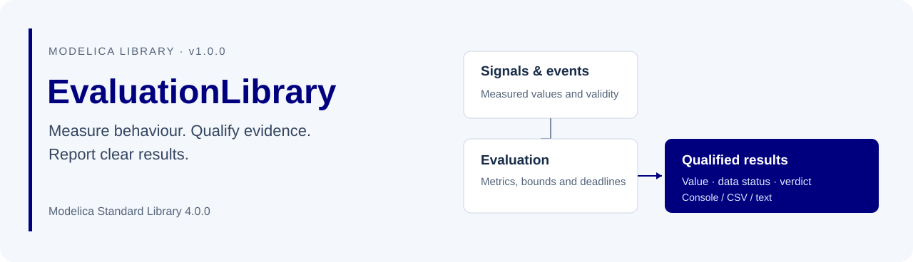
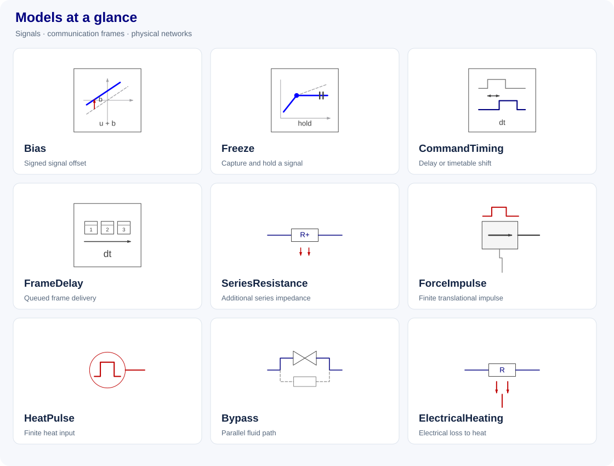

# EvaluationLibrary v1.0.0

**Signal metrics, requirement checks and qualified result reporting for Modelica.**

English · [简体中文](README.zh-CN.md) · [Learning guide](docs/LearningGuide.html) · [Model reference](docs/LearningGuide.html#reference)



EvaluationLibrary observes simulation signals and events, calculates numerical metrics, checks requirements and reports results together with their data quality. It provides 75 public evaluation blocks in seven packages, supporting result types and functions, and nine self-contained examples. The library depends only on **Modelica Standard Library 4.0.0**.

## What you can do

- Assess several signals with one `Statistics.SignalAssessment`, using a shared observation window and sample grid.
- Measure continuous or sampled statistics, transient responses, classification performance and finite-window spectra.
- Check value limits, persistence, response deadlines and recovery dwell with explicit validity conditions.
- Connect complete results directly to console, CSV or text writers; keep numerical availability, data status and requirement verdict separate.

## Install and run

1. Extract the archive, keeping the `EvaluationLibrary` directory and its contents together.
2. Load **Modelica 4.0.0** in your Modelica environment, then open [`EvaluationLibrary/package.mo`](package.mo).
3. Open [`Examples.MultiSignalAssessment`](Examples/MultiSignalAssessment.mo) and simulate with its stored experiment settings.
4. Inspect `assessment.y`, `assessment.minimum`, `assessment.maximum` and `report.overall`, then read the console summary. The example evaluates angle, position and current over `[0, 2)` s; the position exceeds its configured limit.

The [learning guide](docs/LearningGuide.html) includes two complete modelling exercises, result interpretation, a searchable reference and a Chinese translation. The in-tool [`UsersGuide`](UsersGuide/package.mo) gives a shorter introduction. A Modelica environment with support for the declared dependency is required; compatibility should be checked in the environment used for a project.

For OpenModelica, run the following from the directory containing `EvaluationLibrary`:

```modelica
loadModel(Modelica, {"4.0.0"});
loadFile("EvaluationLibrary/package.mo");
checkModel(EvaluationLibrary.Examples.MultiSignalAssessment);
simulate(EvaluationLibrary.Examples.MultiSignalAssessment,
  startTime=0, stopTime=2.2, numberOfIntervals=220,
  tolerance=1e-7);
getErrorString();
```

## Add an evaluation to a model

Connect measured outputs to an evaluator, configure the observation and acceptance criteria, then connect its result to a writer. Set `metricId` and `unitName` at the evaluator. Match the result-array size to the writer's `n` parameter.

```modelica
within;
model FirstAssessment "Assess a sine signal against an acceptance band"
  Modelica.Blocks.Sources.Sine signal(amplitude=0.8, f=1);
  EvaluationLibrary.Statistics.SignalAssessment assessment(
    n=1,
    metricId={"signal"},
    unitName={"1"},
    lower={-1},
    upper={1},
    windowStop=2,
    samplePeriod=0.01);
  EvaluationLibrary.Results.ConsoleWriter report(
    n=1, runId="first_assessment");
equation
  connect(signal.y, assessment.u[1]);
  connect(assessment.y, report.u);
  annotation(experiment(StartTime=0, StopTime=2.1,
    Interval=0.01, Tolerance=1e-6));
end FirstAssessment;
```

With the stated input, the expected peak is `0.8` and the requirement is satisfied. Increase `signal.amplitude` to `1.2` to observe a violated band. These are expected results derived from the model definition. Save the exercise as a standalone `FirstAssessment.mo`. To place it inside a named package, adjust the `within` clause to that package.

For events, use `Response.EventAssessment`: connect an observed request to `request`, actual response feedback to `response`, and select `Occurrence`, `RequestResponse` or `Recovery` for each task. A request–response task with no qualified request is `NOT_APPLICABLE` after a complete observation. The guide includes a runnable deadline example.

## Library structure

| Package | Scope |
| --- | --- |
| [Signals](Signals/package.mo) | Differences, relative errors, angle wrapping, finite differences and validity gates. |
| [Statistics](Statistics/package.mo) | Continuous and sampled statistics, shared multi-channel assessment and accumulated quantities. |
| [Response](Response/package.mo) | Event counts, request–response matching, recovery, dwell and transient response measures. |
| [Requirements](Requirements/package.mo) | Numeric and Boolean conditions, bands, persistence, deadlines and resource margins. |
| [Comparison](Comparison/package.mo) | Paired signals, channel consistency, finite-run summaries and classification performance. |
| [Frequency](Frequency/package.mo) | Finite sampled spectra, single tones, harmonic distortion, gain/phase and decay ratios. |
| [Results](Results/package.mo) | Aggregate qualified results, calculate scores and write console, CSV or text output. |
| [Utilities](Utilities/package.mo) | Result connectors, records, enumerations, formatting functions and internal observation helpers. |
| [Examples](Examples/package.mo) | Nine small, self-contained examples of the public API. |
| [UsersGuide](UsersGuide/package.mo) | Overview, getting started, conventions and limitations inside the modelling tool. |

## Model icons



The previews are exported from the models' existing `Icon` graphics; instance labels are omitted. The original icons and connector layouts remain available in the modelling environment.

## Choose a block

Use `SignalAssessment` for related numeric channels and `EventAssessment` for related event tasks. Choose an individual block when its specific numerical definition or interface is needed. The following reference lists every public evaluation block; the [complete class reference](docs/LearningGuide.html#reference) also covers supporting classes.

<details>
<summary>All 75 public evaluation blocks</summary>

### Signals

| Block | Purpose |
| --- | --- |
| [`AbsoluteError`](Signals/AbsoluteError.mo) | Absolute difference between two signals |
| [`Difference`](Signals/Difference.mo) | Signed difference between two signals |
| [`FiniteDifference`](Signals/FiniteDifference.mo) | Backward difference of consecutive valid samples |
| [`RelativeError`](Signals/RelativeError.mo) | Signed relative error with a reference magnitude limit |
| [`ValidityGate`](Signals/ValidityGate.mo) | Signal pass-through with range and age qualification |
| [`WrappedAngleError`](Signals/WrappedAngleError.mo) | Signed angular error wrapped to one revolution |
### Statistics

| Block | Purpose |
| --- | --- |
| [`ControlEffort`](Statistics/ControlEffort.mo) | Integrated normalised actuator effort and rated-load duration |
| [`EnergyEfficiency`](Statistics/EnergyEfficiency.mo) | Energy efficiency over an observation interval |
| [`GatedPeak`](Statistics/GatedPeak.mo) | Sampled peak severity during a hazard condition |
| [`Integral`](Statistics/Integral.mo) | Signed integral over an observation interval |
| [`LinearTrend`](Statistics/LinearTrend.mo) | Least-squares linear trend of uniformly sampled values |
| [`SampleExtrema`](Statistics/SampleExtrema.mo) | Sampled extrema, occurrence times and peak-to-peak range |
| [`SampleMean`](Statistics/SampleMean.mo) | Arithmetic mean of uniformly sampled values |
| [`SampleRMS`](Statistics/SampleRMS.mo) | Root mean square of uniformly sampled values |
| [`SampleVariance`](Statistics/SampleVariance.mo) | Sample variance with a configurable degrees-of-freedom correction |
| [`SampledMoments`](Statistics/SampledMoments.mo) | One-pass sampled mean, population variance and RMS |
| [`SignalAssessment`](Statistics/SignalAssessment.mo) | Multi-channel bounds assessment with shared sampling |
| [`TimeMean`](Statistics/TimeMean.mo) | Time-weighted mean of a continuous signal |
| [`TimeRMS`](Statistics/TimeRMS.mo) | Time-weighted root mean square of a continuous signal |
| [`TimeVariance`](Statistics/TimeVariance.mo) | Time-weighted population variance of a continuous signal |
| [`TotalVariation`](Statistics/TotalVariation.mo) | Sum of absolute changes between consecutive samples |
| [`ZeroCrossingOscillation`](Statistics/ZeroCrossingOscillation.mo) | Mean period between observed upward level crossings |
### Response

| Block | Purpose |
| --- | --- |
| [`ConditionOccupancy`](Response/ConditionOccupancy.mo) | Measure condition duration and occupancy fraction |
| [`EventAssessment`](Response/EventAssessment.mo) | Assess multiple event tasks in a shared observation window |
| [`EventIntervals`](Response/EventIntervals.mo) | Measure intervals between successive event rising edges |
| [`FallTime`](Response/FallTime.mo) | Measure the 10% to 90% progress time of a falling step |
| [`FirstOccurrence`](Response/FirstOccurrence.mo) | Record the first valid true condition in a window |
| [`MovingAverage`](Response/MovingAverage.mo) | Compute a continuous mean over a trailing window |
| [`OccurrenceCount`](Response/OccurrenceCount.mo) | Count valid rising events within an observation window |
| [`OvershootUndershoot`](Response/OvershootUndershoot.mo) | Measure sampled overshoot and undershoot of a transition |
| [`RecoveryTime`](Response/RecoveryTime.mo) | Measure recovery delay after a sustained valid return |
| [`RepeatedResponse`](Response/RepeatedResponse.mo) | Measure repeated request-response delays using a bounded FIFO |
| [`ResponseDelay`](Response/ResponseDelay.mo) | Measure the delay between the first request and response edges |
| [`RiseFallTime`](Response/RiseFallTime.mo) | Measure the elapsed time between two directed level crossings |
| [`RiseTime`](Response/RiseTime.mo) | Measure the 10% to 90% progress time of a rising step |
| [`SampleHistory`](Response/SampleHistory.mo) | Store a bounded sequence of samples and scheduled times |
| [`SettlingTime`](Response/SettlingTime.mo) | Confirm the final sustained entry into an error band |
| [`SteadyStateError`](Response/SteadyStateError.mo) | Evaluate sampled error bias and residual spread |
| [`TrackingError`](Response/TrackingError.mo) | Compute continuous integral and RMS tracking errors |
| [`ViolationDuration`](Response/ViolationDuration.mo) | Measure total and longest continuous true durations |
### Requirements

| Block | Purpose |
| --- | --- |
| [`BooleanRequirement`](Requirements/BooleanRequirement.mo) | Check a Boolean condition throughout an observation window |
| [`CircularErrorBound`](Requirements/CircularErrorBound.mo) | Check an inclusive bound on a wrapped angular error |
| [`LabelEpisodeDelay`](Requirements/LabelEpisodeDelay.mo) | Measure detection latency within the first labelled episode |
| [`LowerBound`](Requirements/LowerBound.mo) | Check an inclusive lower bound |
| [`NumericRequirement`](Requirements/NumericRequirement.mo) | Apply numerical acceptance bounds to an existing metric |
| [`ObjectiveCompletion`](Requirements/ObjectiveCompletion.mo) | Check objective completion with a failure veto |
| [`PersistenceLimit`](Requirements/PersistenceLimit.mo) | Limit the duration of each continuous true interval |
| [`ResponseDeadline`](Requirements/ResponseDeadline.mo) | Check repeated request-response deadlines using FIFO pairing |
| [`ResponseTime`](Requirements/ResponseTime.mo) | Check the response latency after the first request |
| [`SignedMargin`](Requirements/SignedMargin.mo) | Compute a normalised resource margin and accumulated deficit |
| [`UpperBound`](Requirements/UpperBound.mo) | Check an inclusive upper bound |
| [`VectorBounds`](Requirements/VectorBounds.mo) | Check independent numerical bounds for multiple channels |
| [`WithinBand`](Requirements/WithinBand.mo) | Check an inclusive interval |
### Comparison

| Block | Purpose |
| --- | --- |
| [`ChannelConsistency`](Comparison/ChannelConsistency.mo) | Instantaneous range of valid simultaneous channels |
| [`Improvement`](Comparison/Improvement.mo) | Absolute and relative improvement between paired results |
| [`LabelPerformance`](Comparison/LabelPerformance.mo) | Sampled binary classification counts and performance ratios |
| [`MultiRunSummary`](Comparison/MultiRunSummary.mo) | Summary of a configured set of comparable result values |
| [`PairedArrivalSkew`](Comparison/PairedArrivalSkew.mo) | Time difference between two first observed arrivals |
| [`PairedDifference`](Comparison/PairedDifference.mo) | Signed difference between comparable completed results |
| [`SampleCorrelation`](Comparison/SampleCorrelation.mo) | Pearson correlation of paired uniform samples |
### Frequency

| Block | Purpose |
| --- | --- |
| [`DecayRatio`](Frequency/DecayRatio.mo) | Mean decay ratio of sampled positive peaks |
| [`DiscreteSpectrum`](Frequency/DiscreteSpectrum.mo) | Single-sided discrete Fourier amplitude spectrum |
| [`HarmonicDistortion`](Frequency/HarmonicDistortion.mo) | Total harmonic distortion over selected harmonics |
| [`SingleFrequency`](Frequency/SingleFrequency.mo) | Amplitude and phase at a selected frequency |
| [`ToneResponse`](Frequency/ToneResponse.mo) | Finite-record input-output gain and phase difference |
### Results

| Block | Purpose |
| --- | --- |
| [`CSVWriter`](Results/CSVWriter.mo) | Write connected result records to a CSV file |
| [`ConsoleWriter`](Results/ConsoleWriter.mo) | Print one summary of connected result records |
| [`EvidenceMonitor`](Results/EvidenceMonitor.mo) | Observation coverage and data-validity monitor |
| [`GradeByThresholds`](Results/GradeByThresholds.mo) | Engineering grade from a normalised score |
| [`MinimumMargin`](Results/MinimumMargin.mo) | Minimum signed margin across a finite set |
| [`SatisfactionFraction`](Results/SatisfactionFraction.mo) | Fraction of satisfied verdicts in a finite set |
| [`TextWriter`](Results/TextWriter.mo) | Write connected result records to a text file |
| [`VerdictAggregator`](Results/VerdictAggregator.mo) | Conjunction of required verdicts with retained result records |
| [`WeightedScore`](Results/WeightedScore.mo) | Weighted mean of normalised scores |
| [`WorstCase`](Results/WorstCase.mo) | Value with the greatest absolute magnitude in a finite set |

</details>

### Supporting interfaces, types and functions

[`MetricOutput`](Utilities/Interfaces/MetricOutput.mo) connects to [`MetricInput`](Utilities/Interfaces/MetricInput.mo). Both carry 30 fixed fields. [`MetricResult`](Utilities/Types/MetricResult.mo) represents the same information as a record with enumerated status fields; connectors use integer enumeration codes.

**Public functions:** [`Aggregate`](Utilities/Functions/Aggregate.mo); [`EvidenceMessage`](Utilities/Functions/EvidenceMessage.mo); [`FormatRow`](Utilities/Functions/FormatRow.mo); [`FormatSummary`](Utilities/Functions/FormatSummary.mo); [`QualifiedCode`](Utilities/Functions/QualifiedCode.mo); [`QuoteCSV`](Utilities/Functions/QuoteCSV.mo); [`SafeIdentifier`](Utilities/Functions/SafeIdentifier.mo); [`SampleCount`](Utilities/Functions/SampleCount.mo); [`StatusFromCode`](Utilities/Functions/StatusFromCode.mo); [`StatusText`](Utilities/Functions/StatusText.mo); [`ToVerdict`](Utilities/Functions/ToVerdict.mo); [`Tone`](Utilities/Functions/Tone.mo); [`VerdictFromCode`](Utilities/Functions/VerdictFromCode.mo); [`VerdictText`](Utilities/Functions/VerdictText.mo).

**Records and enumerations:** [`AssessmentDirection`](Utilities/Types/AssessmentDirection.mo); [`DataStatus`](Utilities/Types/DataStatus.mo); [`EventMode`](Utilities/Types/EventMode.mo); [`EventRole`](Utilities/Types/EventRole.mo); [`EvidenceKind`](Utilities/Types/EvidenceKind.mo); [`Grade`](Utilities/Types/Grade.mo); [`InputInterpretation`](Utilities/Types/InputInterpretation.mo); [`MetricResult`](Utilities/Types/MetricResult.mo); [`NumericComparison`](Utilities/Types/NumericComparison.mo); [`ReportFormat`](Utilities/Types/ReportFormat.mo); [`Sense`](Utilities/Types/Sense.mo); [`SpectralWindow`](Utilities/Types/SpectralWindow.mo); [`Taper`](Utilities/Types/Taper.mo); [`Verdict`](Utilities/Types/Verdict.mo); [`WindowMode`](Utilities/Types/WindowMode.mo); [`WritePolicy`](Utilities/Types/WritePolicy.mo).

[`Utilities.Internal`](Utilities/Internal/package.mo) contains window management, accumulation, event-queue, spectrum and file-writing helpers. Use the public blocks for normal model assembly.

## Read a result

| Field | Meaning |
| --- | --- |
| `value`, `valueAvailable`, `unit` | Numerical result, its availability and its stated unit. Unit labels do not convert values. |
| `dataStatus` | `PENDING`, `COMPLETE`, `INCOMPLETE`, `INVALID` or `NOT_APPLICABLE`. |
| `verdict` | `UNDECIDED`, `SATISFIED`, `VIOLATED`, `INVALID` or `NOT_APPLICABLE`. A descriptive statistic can be complete and undecided. |
| `complete` | Collection has closed; this flag does not assert complete or valid evidence. |
| Window, duration and sample fields | The extent of the observation and the coverage available to the producer. |
| `everViolated`, `firstViolationTime` | A retained violation witness; read the instant only when the flag is true. |
| `eventCountsAvailable`, event counters | Request/event counts supplied by producers that support them. |
| `levelAvailable`, `level` | Optional engineering category, using the configured thresholds. |

Check availability flags before using a stored number. `VerdictAggregator` and the writers qualify incoming decisions against their data status. For required applicable items, the aggregate priority is `INVALID`, then `VIOLATED`, then `UNDECIDED`; all included items must be satisfied to yield `SATISFIED`. No included items yields `NOT_APPLICABLE`.

## Observation and output conventions

- Windows are half open: the start is included and the stop is excluded. Some specialised blocks call the stop parameter `windowEnd`; others use `windowStop`. Set the actual parameters exposed by the selected class.
- A required `valid` input must be connected. Where `useValidInput=false`, the optional validity input is hidden and the block assumes valid input, subject to its numerical checks.
- Sampled extrema describe the sample grid. `SignalAssessment(sampled=false)` checks bounds using continuous event relations while its reported extrema remain sampled. Its `sampled=true` mode checks bounds only at ticks.
- Frequency buffers have fixed capacity. Configure the window and sample grid to provide exactly `nSamples` observations. For example, a 100-point grid starting at zero with `samplePeriod=0.01` uses `[0, 1)` s.
- `CSVWriter` and `TextWriter` use an existing destination directory. `RejectExisting` preserves an existing file; choose `Overwrite` explicitly when replacement is intended. File handling flags describe export, independently of the requirement verdict.
- `WorstCase` and `MultiRunSummary` summarise finite declared inputs. Read each class's assumptions and numerical definition before interpreting the result.

## Examples

All nine examples contain their own sources and result writers. Use their stored experiment annotations.

| Example | Demonstrates |
| --- | --- |
| [`ContinuousAndSampleStatistics`](Examples/ContinuousAndSampleStatistics.mo) | Compare continuous and uniformly sampled statistics |
| [`DiagnosticLabelPerformance`](Examples/DiagnosticLabelPerformance.mo) | Evaluate Boolean diagnostic decisions against reference labels |
| [`FrequencyOrFileOutput`](Examples/FrequencyOrFileOutput.mo) | Estimate a sinusoidal amplitude and write its result |
| [`MultiResultSummary`](Examples/MultiResultSummary.mo) | Combine required verdicts while retaining individual results |
| [`MultiSignalAssessment`](Examples/MultiSignalAssessment.mo) | Assess three numerical signals in a shared window |
| [`RecoveryAndDwell`](Examples/RecoveryAndDwell.mo) | Compare successful and unsuccessful recovery |
| [`RepeatedEventMatching`](Examples/RepeatedEventMatching.mo) | Match repeated request and response edges in FIFO order |
| [`RequestResponseDeadline`](Examples/RequestResponseDeadline.mo) | Compare timely, late, missing and undemanded responses |
| [`WrappedAngleAndSeverity`](Examples/WrappedAngleAndSeverity.mo) | Evaluate wrapped angular errors and configured severity levels |

`FrequencyOrFileOutput` includes an active CSV writer. Its default destination is `frequency_tone.csv` in the simulator's working directory; existing output is preserved.

## Further information

- [English / Chinese learning guide](docs/LearningGuide.html)
- [In-tool User's Guide](UsersGuide/package.mo)
- [Migration notes](migration.md)
- [Licence](LICENSE) — GNU General Public License, version 3; the supplied licence text is retained unchanged.
