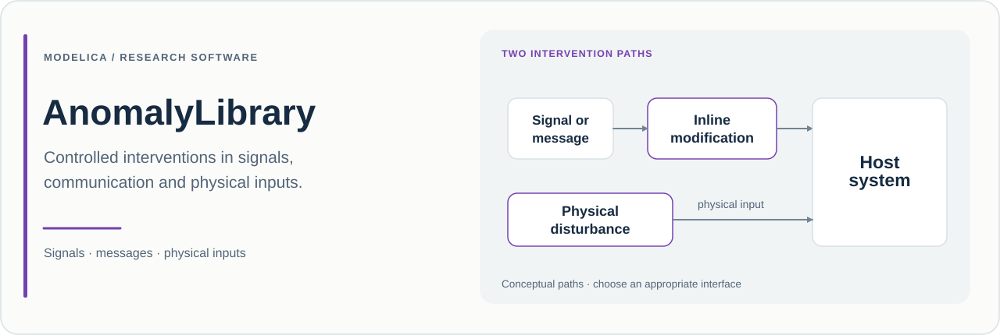

# AnomalyLibrary

**Deterministic anomalies for signals, communication frames and physical interfaces in Modelica.**

**English** · [简体中文](README_zh.md)

<!-- learning-guide:start -->
> **[Detailed bilingual learning and usage guide](docs/LearningGuide.html)** — Chinese and British English in one offline-readable HTML file, with a complete component reference and every example explained. Download the HTML and open it in a browser to use language switching and search.
<!-- learning-guide:end -->

[](package.mo)
[](package.mo)

[Purpose](#purpose) · [Implementation](#how-it-works) · [Quick start](#quick-start) · [Examples](#examples) · [Research use](#research-use)

## Purpose

AnomalyLibrary provides configurable disturbances that can be inserted into a Modelica experiment at a signal path, a communication interface or a physical connection. Its purpose is to make abnormal conditions **explicit, repeatable and observable**.

The library supports questions such as: how does a controller respond to a held measurement; what changes when messages are delayed or duplicated; how does an additional electrical load or a mechanical impulse propagate through a system; and what happens when a command is omitted, mistimed or prolonged?

Different intervention mechanisms are represented by different models. A signal transformation changes what a receiver observes. A frame policy changes the delivery of identified messages. A physical branch changes a network's constitutive relations or introduces an external excitation. This distinction helps researchers choose an intervention that matches the phenomenon under study.

## At a glance

| Item | Current source |
| :--- | :--- |
| Modelica package | `AnomalyLibrary` |
| Declared version | **0.3.0**, in [package.mo](package.mo) |
| External Modelica dependency | **Modelica 4.0.0** |
| Starting example | [Examples.SignalDeviationAndRecovery](Examples/SignalDeviationAndRecovery.mo) |
| Included experiments | **9** models in [Examples](Examples) |
| Model inventory | [model-catalog.csv](model-catalog.csv) |
| Version history | [CHANGELOG.md](CHANGELOG.md) |
| Reviewed source baseline | [`e84ef50`](https://github.com/Ruizhe-Yang/AnomalyLibrary/commit/e84ef5068e0b11c1677cb51d40cb577a4cf382f8), 12 November 2026 |

The source version is distinct from a GitHub release or tag. Record the Git commit used in each study.

## How it works

### Signals and command behaviour

The [Signals](Signals) package includes bias, gain error, drift, freezing, delay, quantisation, limiting and Boolean command interventions. Models with the common activation interface accept `enabled`, `startTime`, `endTime`, `severity` and, where applicable, `transitionTime` or an external `trigger`.

[Freeze](Signals/Freeze.mo) captures the input at activation and restores the live input when the event ends. Discrete interventions enforce deterministic severity values of zero or one. [CommandTiming](Signals/CommandTiming.mo) distinguishes a causal online delay from a signed shift of a known timetable; advancing an unknown future input is not an available operation. [CommandDuration](Signals/CommandDuration.mo) exposes `effectActive` because an accepted replacement pulse can continue after the activation window closes.

Set activation explicitly for the chosen model. Some classes retain the `eventStartTime`/`eventEndTime` interface, and defaults differ. In particular, [NoiseInjection](Signals/NoiseInjection.mo) adds an **external noise input**; it does not generate a random process internally.

### Identified frames and a bounded delivery queue

[Communication](Communication) provides delay, dropout, reordering, duplication, replay, outages, throttling, payload corruption and timing interventions. Its frame interface separates:

| Field | Meaning |
| :--- | :--- |
| `txCount` | Transmission event counter; advance by one per new input frame |
| `sequence`, `sourceTime` | Identity and timestamp attached to the source frame |
| `rxCount` | Reception event counter, including repeated receptions |
| `receivedSequence`, `receivedSourceTime` | Identity and timestamp of the delivered frame |
| `available`, `validOut` | Availability and qualification of the retained output |

The [frame queue](Utilities/Internal/FrameQueue.mo) has finite capacity and a configured service period. Observe `queueLength`, `droppedCount`, `overflow`, `inputSequenceError` and `serviceDelay` when interpreting results. Read a new delivery on a change in `rxCount`; repeated payload values or repeated sequence numbers alone do not identify a reception. Recovery discards pending queued frames and accounts for them as drops.

### Physical interventions

Physical models use domain connectors for additional loads, leakage or bypass paths, finite series impedances, forces, torques, heat flows and environmental exchange. For example, [SeriesResistance](Electrical/SeriesResistance.mo) exposes electrical loss and an optional heat port. Connect an intervention according to its series, parallel or source role; it should represent the intended physical change in the host topology.

## Package map

| Package | Main content |
| :--- | :--- |
| [Signals](Signals) | Measurement transformations and unsafe command patterns |
| [Communication](Communication) | Deterministic frame-delivery and timestamp policies |
| [Electrical](Electrical) | Added loads, series/parallel disturbances, ripple and voltage sag |
| [Mechanics](Mechanics) | Force/torque disturbances, impulses, contact and release |
| [Thermal](Thermal) | Heat input, heat pulses, ambient shifts and radiation |
| [Fluid](Fluid) | Added resistance, bypass, injection, pressure ingress and venting |
| [CrossDomain](CrossDomain) | Electrical heating, pressure-to-force and impact-to-measurement effects |
| [Utilities](Utilities) | Activation logic, frame queue and internal helpers |
| [UsersGuide](UsersGuide) / [Examples](Examples) | In-tool guidance and experiment definitions |

## Quick start

Make **MSL 4.0.0** available in your Modelica tool, then clone and load the package:

```sh
git clone https://github.com/Ruizhe-Yang/AnomalyLibrary.git AnomalyLibrary
cd AnomalyLibrary
```

In a graphical tool, load `package.mo` and simulate `AnomalyLibrary.Examples.SignalDeviationAndRecovery` using **0–4 s**, output interval **0.008 s**, tolerance **1e-6**.

For OpenModelica, save the following as `quickstart.mos` in the repository root and run `omc quickstart.mos`:

```modelica
loadModel(Modelica, {"4.0.0"});
loadFile("package.mo");
checkModel(AnomalyLibrary.Examples.SignalDeviationAndRecovery);
simulate(AnomalyLibrary.Examples.SignalDeviationAndRecovery,
  startTime=0, stopTime=4, numberOfIntervals=500,
  tolerance=1e-6);
getErrorString();
```

Plot `ramp.y`, `biasValue`, `freezeValue` and `gainValue`. The example applies three independent interventions to the same ramp over **[1, 2) s**, making the activation and return to the live signal easy to inspect. Next, open `DeterministicCommunication` and compare frame identities together with each policy's `rxCount`.

## Examples

All models below belong to `AnomalyLibrary.Examples`.

| Example | Study and useful signals |
| :--- | :--- |
| [SignalDeviationAndRecovery](Examples/SignalDeviationAndRecovery.mo) | Bias, freezing and gain error; `biasValue`, `freezeValue`, `gainValue` |
| [DeterministicCommunication](Examples/DeterministicCommunication.mo) | Four frame policies on a shared service grid; `dropId`, `delayId`, `reorderId`, `duplicateId`, and policy `rxCount`/queue diagnostics |
| [ElectricalDisturbances](Examples/ElectricalDisturbances.mo) | Parallel conductance and a separate series ripple; `extraPath.i`, `rippleLoad.i` |
| [MechanicalImpulseAndContact](Examples/MechanicalImpulseAndContact.mo) | Translational/angular impulses and a contact stop; `forceBody.v`, `torqueBody.w`, `contactBody.s` |
| [ThermalPulseAndEnvironment](Examples/ThermalPulseAndEnvironment.mo) | Heat pulse, shifted ambient and radiation; `pulseBody.T`, `ambientBody.T`, `radiationBody.T` |
| [FluidPathDisturbances](Examples/FluidPathDisturbances.mo) | A parallel bypass between explicit boundaries; `mainPath.m_flow`, `extraPath.port_a.m_flow`; optional reverse-flow configuration |
| [UnsafeCommandPatterns](Examples/UnsafeCommandPatterns.mo) | Omission, spurious command, timing and duration; the four `*Value` outputs |
| [CrossDomainEffects](Examples/CrossDomainEffects.mo) | Electrical dissipation into heat and pressure-driven force; `heater.lossPower`, `body.T`, `force.flange.f` |
| [CombinedAnomalies](Examples/CombinedAnomalies.mo) | Serial bias, delay and hold versus a direct path; `modified`, `nominal` |

## Research use

Establish the host's nominal response, choose an intervention location, and document its physical or informational meaning. Keep the stimulus and initial conditions fixed when comparing alternatives. For serial signal interventions, record the ordering: bias followed by freezing can produce a different experiment from freezing followed by bias.

Record the **repository URL, source version, commit, model path, activation parameters, topology, initial conditions, tool/MSL versions and solver settings**. Frame studies should additionally record payload dimensions, queue capacity, service period, sequence policy and input qualification. Cite the actual software snapshot.

### Scope and assumptions

- The implemented policies are deterministic. They do not supply failure probabilities or a stochastic network model.
- Physical sources and finite impedances require parameters consistent with the host system and its operating range.
- Frame timing follows the configured service grid. A retained output is not automatically a newly delivered or valid measurement.
- The examples demonstrate configured mechanisms; they do not establish every possible combination or host-system behaviour.

## Development and licensing

For issues or contributions, provide a small host model, the intervention parameters, nominal and modified traces, and the tool/MSL versions. Communication issues are most useful when they include transmitted and received counters, sequence identities and queue diagnostics.

See [LICENSE](LICENSE) for repository licensing and [CHANGELOG.md](CHANGELOG.md) for migration information.
