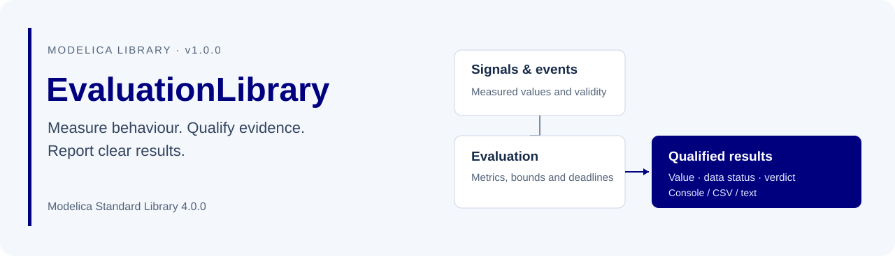
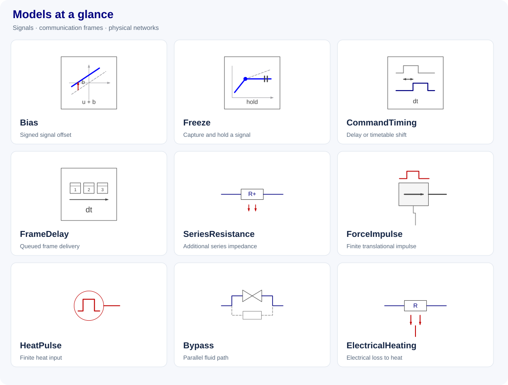

# EvaluationLibrary v1.0.0

**用于 Modelica 的信号指标计算、要求判定与结果报告库。**

[English](README.md) · 简体中文 · [双语教程](docs/LearningGuide.html) · [完整模型索引](docs/LearningGuide.html#reference)



EvaluationLibrary 观测仿真中的信号与事件，计算数值指标、检查要求，并同时输出结果及其数据有效性信息。库包含 7 个功能包中的 **75 个公开评价模块**、完整结果类型与支撑函数，以及 **9 个自包含示例**。唯一库依赖为 **Modelica Standard Library 4.0.0**。

## 快速开始

1. 解压后保留 `EvaluationLibrary` 文件夹及其完整目录结构。
2. 在 Modelica 环境中先加载 **Modelica 4.0.0**，再打开 [`package.mo`](package.mo)。
3. 打开 [`Examples.MultiSignalAssessment`](Examples/MultiSignalAssessment.mo)，使用模型自带的实验设置仿真。
4. 查看 `assessment.y`、`assessment.minimum`、`assessment.maximum`、`report.overall` 和控制台摘要。示例在 `[0, 2)` s 内评价角度、位移与电流，其中位移超过设定限值。

[双语教程](docs/LearningGuide.html) 默认显示英文，可切换为中文，包含两个完整建模练习、结果解读和可检索模型索引。建模工具内可直接阅读 [`UsersGuide`](UsersGuide/package.mo)。请在实际使用的 Modelica 环境中检查库与所声明依赖的兼容性。

## 在自己的模型中使用

将被观测量连接到评价模块，设置观测窗口与接受条件，再将完整结果连接到输出模块。`metricId`、`unitName` 在评价端设置；输出数组维数应与输出模块的 `n` 一致。

```modelica
within;
model FirstAssessment "Assess a sine signal against an acceptance band"
  Modelica.Blocks.Sources.Sine signal(amplitude=0.8, f=1);
  EvaluationLibrary.Statistics.SignalAssessment assessment(
    n=1,
    metricId={"signal"},
    unitName={"1"},
    lower={-1},
    upper={1},
    windowStop=2,
    samplePeriod=0.01);
  EvaluationLibrary.Results.ConsoleWriter report(
    n=1, runId="first_assessment");
equation
  connect(signal.y, assessment.u[1]);
  connect(assessment.y, report.u);
  annotation(experiment(StartTime=0, StopTime=2.1,
    Interval=0.01, Tolerance=1e-6));
end FirstAssessment;
```

将此代码保存为独立的 `FirstAssessment.mo`。若放入命名包，应将 `within` 子句改为对应包名。按模型定义，输入幅值为 `0.8` 时采样峰值预期为 `0.8`，判定为满足；将 `signal.amplitude` 改为 `1.2` 后将违反设定区间。这里给出的是由模型定义推导的预期结果。

多通道数值评价优先使用 `Statistics.SignalAssessment`；相关事件任务可使用 `Response.EventAssessment`。后者分别连接实际请求 `request` 与实际响应反馈 `response`，按任务选择事件统计、请求响应匹配或恢复驻留。在完整窗口中没有合格请求时，请求响应任务为 `NOT_APPLICABLE`。教程中包含可直接使用的期限判定练习。

## 库结构

| 包 | 主要内容 |
| --- | --- |
| [Signals](Signals/package.mo) | 计算差值、相对误差、角度环绕误差、差分导数，并标记信号有效性。 |
| [Statistics](Statistics/package.mo) | 连续与采样统计、多通道统一评价，以及积分、能量等累积量。 |
| [Response](Response/package.mo) | 事件计数、请求—响应匹配、恢复与驻留，以及瞬态响应指标。 |
| [Requirements](Requirements/package.mo) | 数值与布尔条件、上下限、持续性、响应期限及资源裕度。 |
| [Comparison](Comparison/package.mo) | 成对信号比较、通道一致性、有限运行结果汇总与分类性能。 |
| [Frequency](Frequency/package.mo) | 有限采样频谱、单频幅值、谐波失真、增益/相位和衰减比。 |
| [Results](Results/package.mo) | 汇总具有数据资格信息的结果、计算评分，并输出控制台、CSV 或文本。 |
| [Utilities](Utilities/package.mo) | 结果连接器、记录、枚举、格式化函数及内部观测支撑模型。 |
| [Examples](Examples/package.mo) | 9 个自包含示例，展示主要公开接口的使用。 |
| [UsersGuide](UsersGuide/package.mo) | 在建模工具中阅读概述、入门步骤、约定与使用边界。 |

## 模型图标



展示图由模型现有 `Icon` 图形导出，省略实例名。模型内部图标和连接器布局保持原样。

## 模型选型

下表列出全部公开评价模块；[完整索引](docs/LearningGuide.html#reference) 还包含结果接口、类型、函数与内部支撑类。选型时请以模型自带英文说明中的输入、参数和数值定义为准。

<details>
<summary>展开全部 75 个公开评价模块</summary>

### Signals · 信号预处理

| 模型 | 用途 |
| --- | --- |
| [`AbsoluteError`](Signals/AbsoluteError.mo) | 计算相对于参考输入的绝对误差。 |
| [`Difference`](Signals/Difference.mo) | 计算两个输入之差。 |
| [`FiniteDifference`](Signals/FiniteDifference.mo) | 在统一采样网格上估计信号变化率。 |
| [`RelativeError`](Signals/RelativeError.mo) | 以参考值绝对值归一化误差，并检查分母下限。 |
| [`ValidityGate`](Signals/ValidityGate.mo) | 透传输入，并依据外部有效性、值域和数据年龄输出有效标志。 |
| [`WrappedAngleError`](Signals/WrappedAngleError.mo) | 将弧度角差映射至主值区间。 |
### Statistics · 信号统计

| 模型 | 用途 |
| --- | --- |
| [`ControlEffort`](Statistics/ControlEffort.mo) | 积分归一化控制量的平方，并统计达到额定幅值的时长。 |
| [`EnergyEfficiency`](Statistics/EnergyEfficiency.mo) | 根据输入、输出功率积分计算能量效率。 |
| [`GatedPeak`](Statistics/GatedPeak.mo) | 记录指定条件下的采样峰值。 |
| [`Integral`](Statistics/Integral.mo) | 在有效观测窗口内积分输入信号。 |
| [`LinearTrend`](Statistics/LinearTrend.mo) | 对有效样本估计线性趋势。 |
| [`SampleExtrema`](Statistics/SampleExtrema.mo) | 记录采样最小值、最大值与极值时刻。 |
| [`SampleMean`](Statistics/SampleMean.mo) | 计算有效样本的算术均值。 |
| [`SampleRMS`](Statistics/SampleRMS.mo) | 计算有效样本的均方根。 |
| [`SampleVariance`](Statistics/SampleVariance.mo) | 计算带可配置自由度修正的采样方差，默认 ddof=1。 |
| [`SampledMoments`](Statistics/SampledMoments.mo) | 在同一采样网格上计算均值、均方根与总体方差。 |
| [`SignalAssessment`](Statistics/SignalAssessment.mo) | 在共享窗口内评价多通道信号、边界与可选等级。 |
| [`TimeMean`](Statistics/TimeMean.mo) | 按有效观测时间计算连续时间均值。 |
| [`TimeRMS`](Statistics/TimeRMS.mo) | 按有效观测时间计算连续时间均方根。 |
| [`TimeVariance`](Statistics/TimeVariance.mo) | 计算连续时间总体方差。 |
| [`TotalVariation`](Statistics/TotalVariation.mo) | 累计相邻有效样本之差的绝对值。 |
| [`ZeroCrossingOscillation`](Statistics/ZeroCrossingOscillation.mo) | 根据连续观测的向上阈值穿越估计平均周期。 |
### Response · 事件与响应

| 模型 | 用途 |
| --- | --- |
| [`ConditionOccupancy`](Response/ConditionOccupancy.mo) | 统计条件成立的观测时间及占比。 |
| [`EventAssessment`](Response/EventAssessment.mo) | 在共享窗口内统计事件、匹配请求响应或确认恢复驻留。 |
| [`EventIntervals`](Response/EventIntervals.mo) | 统计合格事件之间的时间间隔。 |
| [`FallTime`](Response/FallTime.mo) | 测量下降过程中两个阈值间的时间。 |
| [`FirstOccurrence`](Response/FirstOccurrence.mo) | 记录窗口内首次有效真条件的时刻，包含左边界。 |
| [`MovingAverage`](Response/MovingAverage.mo) | 根据连续积分及延迟计算滑动时间均值。 |
| [`OccurrenceCount`](Response/OccurrenceCount.mo) | 统计观测窗口内合格事件的次数。 |
| [`OvershootUndershoot`](Response/OvershootUndershoot.mo) | 按声明阶跃幅值计算采样超调率和反向偏离率。 |
| [`RecoveryTime`](Response/RecoveryTime.mo) | 测量首次危险事件之后满足有效驻留的恢复时间。 |
| [`RepeatedResponse`](Response/RepeatedResponse.mo) | 逐个匹配重复请求与响应，并保存有限延迟历史。 |
| [`ResponseDelay`](Response/ResponseDelay.mo) | 测量首次合格请求响应对的延迟。 |
| [`RiseFallTime`](Response/RiseFallTime.mo) | 测量指定上升或下降过程的阈值穿越时间。 |
| [`RiseTime`](Response/RiseTime.mo) | 测量上升过程中两个阈值间的时间。 |
| [`SampleHistory`](Response/SampleHistory.mo) | 保存有界采样历史。 |
| [`SettlingTime`](Response/SettlingTime.mo) | 估计信号进入并保持在稳定带内的时间。 |
| [`SteadyStateError`](Response/SteadyStateError.mo) | 计算指定观测窗口内的采样误差均值与标准差。 |
| [`TrackingError`](Response/TrackingError.mo) | 计算跟踪误差及相关累积指标。 |
| [`ViolationDuration`](Response/ViolationDuration.mo) | 累计条件违反的有效持续时间。 |
### Requirements · 要求判定

| 模型 | 用途 |
| --- | --- |
| [`BooleanRequirement`](Requirements/BooleanRequirement.mo) | 对布尔要求进行窗口内判定。 |
| [`CircularErrorBound`](Requirements/CircularErrorBound.mo) | 对弧度环绕误差进行界限判定。 |
| [`LabelEpisodeDelay`](Requirements/LabelEpisodeDelay.mo) | 测量首个真实标签区段内的检测延迟。 |
| [`LowerBound`](Requirements/LowerBound.mo) | 检查信号是否满足包含边界的下限。 |
| [`NumericRequirement`](Requirements/NumericRequirement.mo) | 根据所选比较方式判定数值要求。 |
| [`ObjectiveCompletion`](Requirements/ObjectiveCompletion.mo) | 检查窗口内目标完成，并应用故障否决。 |
| [`PersistenceLimit`](Requirements/PersistenceLimit.mo) | 检查条件持续时间是否超过给定上限。 |
| [`ResponseDeadline`](Requirements/ResponseDeadline.mo) | 对重复请求与响应执行期限判定。 |
| [`ResponseTime`](Requirements/ResponseTime.mo) | 记录并检查请求响应延迟。 |
| [`SignedMargin`](Requirements/SignedMargin.mo) | 计算归一化资源裕度和缺额累积量。 |
| [`UpperBound`](Requirements/UpperBound.mo) | 检查信号是否满足包含边界的上限。 |
| [`VectorBounds`](Requirements/VectorBounds.mo) | 同时检查多个信号的上下界。 |
| [`WithinBand`](Requirements/WithinBand.mo) | 检查信号是否位于包含边界的接受区间。 |
### Comparison · 对比分析

| 模型 | 用途 |
| --- | --- |
| [`ChannelConsistency`](Comparison/ChannelConsistency.mo) | 评价当前窗口内多个通道的一致性范围。 |
| [`Improvement`](Comparison/Improvement.mo) | 按改善方向报告绝对与相对改善量。 |
| [`LabelPerformance`](Comparison/LabelPerformance.mo) | 计算 TP、TN、FP、FN 和四项分类性能比率。 |
| [`MultiRunSummary`](Comparison/MultiRunSummary.mo) | 汇总预先声明可比的有限组运行结果。 |
| [`PairedArrivalSkew`](Comparison/PairedArrivalSkew.mo) | 测量成对事件的到达偏差。 |
| [`PairedDifference`](Comparison/PairedDifference.mo) | 计算两个可比完整结果之间的有符号差值。 |
| [`SampleCorrelation`](Comparison/SampleCorrelation.mo) | 计算成对有效样本的相关性。 |
### Frequency · 频域分析

| 模型 | 用途 |
| --- | --- |
| [`DecayRatio`](Frequency/DecayRatio.mo) | 根据采样峰值计算振荡衰减比。 |
| [`DiscreteSpectrum`](Frequency/DiscreteSpectrum.mo) | 对固定长度采样序列计算单边离散频谱。 |
| [`HarmonicDistortion`](Frequency/HarmonicDistortion.mo) | 估计有限采样窗口内的谐波失真。 |
| [`SingleFrequency`](Frequency/SingleFrequency.mo) | 估计指定频率的幅值与相位。 |
| [`ToneResponse`](Frequency/ToneResponse.mo) | 根据参考与响应采样估计单频增益和相位差。 |
### Results · 结果与报告

| 模型 | 用途 |
| --- | --- |
| [`CSVWriter`](Results/CSVWriter.mo) | 将连接的完整结果按原顺序导出为 CSV。 |
| [`ConsoleWriter`](Results/ConsoleWriter.mo) | 在观测结束时输出完整结果和总体判定。 |
| [`EvidenceMonitor`](Results/EvidenceMonitor.mo) | 监视观测窗口、有效时长及样本覆盖情况。 |
| [`GradeByThresholds`](Results/GradeByThresholds.mo) | 按给定阈值将评分映射为等级。 |
| [`MinimumMargin`](Results/MinimumMargin.mo) | 计算输入裕度中的最小值。 |
| [`SatisfactionFraction`](Results/SatisfactionFraction.mo) | 计算适用条目中满足要求的比例。 |
| [`TextWriter`](Results/TextWriter.mo) | 将连接的完整结果导出为文本。 |
| [`VerdictAggregator`](Results/VerdictAggregator.mo) | 汇总必需且适用条目的判定，并保留子结果。 |
| [`WeightedScore`](Results/WeightedScore.mo) | 根据明确权重计算综合评分。 |
| [`WorstCase`](Results/WorstCase.mo) | 选择绝对值最大的输入并保留原符号。 |

</details>

### 支撑接口与类型

`MetricOutput` 与 `MetricInput` 是具有 30 个固定字段的完整结果连接器；`MetricResult` 为相应记录类型。连接器的状态字段采用整数枚举代码，记录采用枚举类型。`Utilities.Functions` 提供格式化、状态转换、合成判定和有限采样处理函数；`Utilities.Internal` 为内部实现支撑，常规建模应使用公开模块。

## 结果如何解读

| 字段 | 含义 |
| --- | --- |
| `value`、`valueAvailable`、`unit` | 数值、可用标志和单位说明。单位标签不会自动换算输入。 |
| `dataStatus` | 数据是否待完成、完整、不完整、无效或不适用。 |
| `verdict` | 要求是否未决、满足、违反、无效或不适用。统计量可以数据完整而要求判定仍未决。 |
| `complete` | 本次数据收集已结束，不代表证据完整或要求满足。 |
| 窗口、时长和样本数字段 | 观测范围与实际覆盖情况。 |
| `everViolated`、`firstViolationTime` | 已记录的违反及首次发生时刻；只有标志为真时才解读时刻。 |
| 事件与等级可用标志 | 仅在对应标志为真时解读事件计数或工程等级。 |

总体判定仅纳入必需且适用的条目，优先级为 `INVALID`、`VIOLATED`、`UNDECIDED`；全部纳入条目满足才得到 `SATISFIED`，无适用条目则为 `NOT_APPLICABLE`。读取数字前必须检查其可用标志。

## 配置要点

- 观测窗口为左闭右开。不同模块分别使用 `windowStop` 或 `windowEnd`，不能混用参数名。
- 必选的 `valid` 输入必须连接；提供 `useValidInput` 的模块可按需启用有效性连接器。具体失效检测规则见对应模型说明。
- 采样极值仅代表采样网格。`SignalAssessment(sampled=false)` 用连续事件关系检查界限，同时仍以采样方式报告极值。
- 固定容量的频谱模块需要恰好 `nSamples` 个采样点。例如从零开始、步长 `0.01` s 的 100 点采样应配置窗口 `[0, 1)` s。
- 文件输出目录应事先存在。默认 `RejectExisting` 保留已有文件；只有明确选择 `Overwrite` 才覆盖。文件写入成功与否不改变要求判定。
- 有限候选集合的汇总结果应按对应模型定义解释；不同专用模型的有效性检测和结果保持方式有所不同。

## 示例

| 示例 | 展示内容 |
| --- | --- |
| [`ContinuousAndSampleStatistics`](Examples/ContinuousAndSampleStatistics.mo) | 比较连续与采样统计。 |
| [`DiagnosticLabelPerformance`](Examples/DiagnosticLabelPerformance.mo) | 展示分类计数和比率。 |
| [`FrequencyOrFileOutput`](Examples/FrequencyOrFileOutput.mo) | 测量单频分量并输出控制台与 CSV。 |
| [`MultiResultSummary`](Examples/MultiResultSummary.mo) | 汇总多个完整结果。 |
| [`MultiSignalAssessment`](Examples/MultiSignalAssessment.mo) | 统一评价角度、位移和电流。 |
| [`RecoveryAndDwell`](Examples/RecoveryAndDwell.mo) | 比较成功恢复与未成功满足恢复驻留的情况。 |
| [`RepeatedEventMatching`](Examples/RepeatedEventMatching.mo) | 展示重复请求响应的有限队列匹配。 |
| [`RequestResponseDeadline`](Examples/RequestResponseDeadline.mo) | 比较及时、同时、缺失及迟到的响应。 |
| [`WrappedAngleAndSeverity`](Examples/WrappedAngleAndSeverity.mo) | 展示弧度环绕误差和工程等级。 |

`FrequencyOrFileOutput` 中已经连接 CSV 输出模块，默认向仿真工作目录写入 `frequency_tone.csv`，已有文件会保留。

## 其他入口

- [默认英文、可切换中文的教程](docs/LearningGuide.html)
- [工具内使用指南](UsersGuide/package.mo)
- [迁移说明](migration.md)
- [许可证](LICENSE)：GNU General Public License v3，原始许可文本保持不变。
