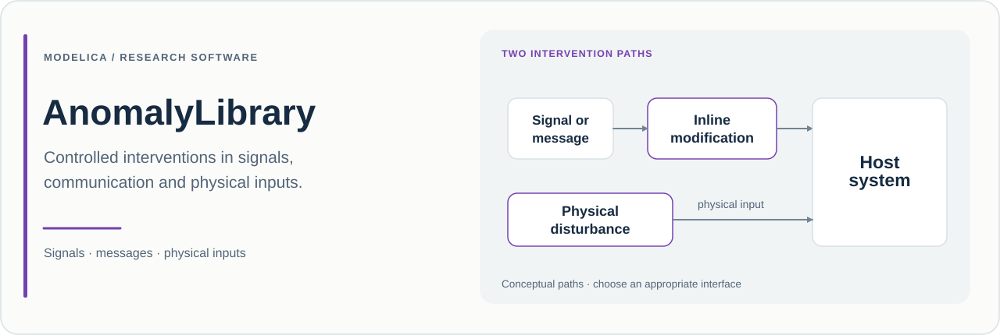

# AnomalyLibrary

**面向 Modelica 信号、通信报文与物理接口的确定性异常模型。**

[English](README.md) · **简体中文**

[](package.mo)
[](package.mo)

## 项目目的

AnomalyLibrary 提供可插入 Modelica 实验中的可配置扰动，作用位置包括信号通路、通信接口及物理连接。目标是让异常条件具有**明确表达、可重复配置和可观察行为**。

本库支持研究：测量值冻结后控制器如何响应；报文延迟或重复会带来什么变化；附加电负载或机械冲量如何传播；指令遗漏、时序偏移或持续时间改变会产生何种后果。

不同干预机理由不同模型表达。信号变换改变接收方观察到的内容；报文策略改变带身份信息的消息交付；物理支路改变网络本构关系或施加外部激励。这种区分有助于选择与研究现象相符的干预方式。

## 当前源码概况

| 项目 | 内容 |
| :--- | :--- |
| Modelica 包名 | `AnomalyLibrary` |
| 声明版本 | **0.3.0**，见 [package.mo](package.mo) |
| 外部 Modelica 依赖 | **Modelica 4.0.0** |
| 推荐起点 | [Examples.SignalDeviationAndRecovery](Examples/SignalDeviationAndRecovery.mo) |
| 示例数量 | [Examples](Examples) 中的 **9** 个实验模型 |
| 模型索引 | [model-catalog.csv](model-catalog.csv) |
| 版本记录 | [CHANGELOG.md](CHANGELOG.md) |
| 说明核对基线 | [`e84ef50`](https://github.com/Ruizhe-Yang/AnomalyLibrary/commit/e84ef5068e0b11c1677cb51d40cb577a4cf382f8)；核对日期 2026-11-12 |

源码版本不同于 GitHub 发布或标签。每次研究还应记录实际使用的 Git 提交。

## 实现方式

### 信号与指令行为

[Signals](Signals) 包提供偏差、增益误差、漂移、冻结、延迟、量化、限幅及布尔指令干预。采用通用激活接口的模型使用 `enabled`、`startTime`、`endTime`、`severity`，并根据模型性质提供 `transitionTime` 或外部 `trigger`。

[Freeze](Signals/Freeze.mo) 在激活时捕获输入，事件结束后恢复实时输入。离散干预要求严重度为确定性的零或一。[CommandTiming](Signals/CommandTiming.mo) 区分在线因果延迟与已知时间表的正负平移，不提供对未知未来输入的提前读取。[CommandDuration](Signals/CommandDuration.mo) 提供 `effectActive`，因为已接受的替换脉冲可能在激活窗口结束后继续存在。

应显式配置所选模型的激活方式。部分模型保留 `eventStartTime`/`eventEndTime` 接口，各类默认值也不同。特别是 [NoiseInjection](Signals/NoiseInjection.mo) 叠加的是**外部噪声输入**，内部并不生成随机过程。

### 带身份信息的报文与有限交付队列

[Communication](Communication) 提供延迟、丢失、乱序、重复、重放、中断、节流、载荷破坏及时间相关干预。报文接口分别表达：

| 字段 | 含义 |
| :--- | :--- |
| `txCount` | 发送事件计数；每个新输入报文递增一 |
| `sequence`、`sourceTime` | 源报文携带的身份与时间戳 |
| `rxCount` | 接收事件计数，包含重复接收 |
| `receivedSequence`、`receivedSourceTime` | 已交付报文的身份与时间戳 |
| `available`、`validOut` | 当前保留输出的可用性与有效性 |

[报文队列](Utilities/Internal/FrameQueue.mo) 具有有限容量和可配置服务周期。解释结果时，应同时观察 `queueLength`、`droppedCount`、`overflow`、`inputSequenceError` 和 `serviceDelay`。`rxCount` 变化表示新的交付事件；仅依据载荷变化或序号变化，无法正确识别重复接收。恢复时会丢弃仍在等待的报文，并计入丢失数量。

### 物理干预

物理模型使用领域连接器，表达附加载荷、泄漏或旁路、有限串联阻抗、力、力矩、热流和环境交换。例如，[SeriesResistance](Electrical/SeriesResistance.mo) 提供电损耗及可选热端口。应依据串联、并联或外部源的角色连接干预元件，使宿主拓扑反映预期的物理变化。

## 包结构

| 包 | 主要内容 |
| :--- | :--- |
| [Signals](Signals) | 测量变换及不安全指令模式 |
| [Communication](Communication) | 确定性报文交付与时间戳策略 |
| [Electrical](Electrical) | 附加载荷、串并联扰动、纹波及电压跌落 |
| [Mechanics](Mechanics) | 力/力矩扰动、冲量、接触与释放 |
| [Thermal](Thermal) | 热输入、热脉冲、环境温度变化与辐射 |
| [Fluid](Fluid) | 附加阻力、旁路、注入、压力侵入及泄放 |
| [CrossDomain](CrossDomain) | 电热、压力到力、冲击到测量的影响 |
| [Utilities](Utilities) | 激活逻辑、报文队列与内部辅助模型 |
| [UsersGuide](UsersGuide) / [Examples](Examples) | 工具内说明与实验定义 |

## 快速开始

确保 Modelica 工具中的 **MSL 4.0.0** 可用，然后克隆并加载库：

```sh
git clone https://github.com/Ruizhe-Yang/AnomalyLibrary.git AnomalyLibrary
cd AnomalyLibrary
```

在图形工具中加载 `package.mo`，打开 `AnomalyLibrary.Examples.SignalDeviationAndRecovery`，按 **0–4 s**、输出间隔 **0.008 s**、容差 **1e-6** 仿真。

使用 OpenModelica 时，可将以下内容保存为仓库根目录下的 `quickstart.mos`，运行 `omc quickstart.mos`：

```modelica
loadModel(Modelica, {"4.0.0"});
loadFile("package.mo");
checkModel(AnomalyLibrary.Examples.SignalDeviationAndRecovery);
simulate(AnomalyLibrary.Examples.SignalDeviationAndRecovery,
  startTime=0, stopTime=4, numberOfIntervals=500,
  tolerance=1e-6);
getErrorString();
```

绘制 `ramp.y`、`biasValue`、`freezeValue` 和 `gainValue`。示例在 **[1, 2) s** 对同一个斜坡分别施加三种独立干预，便于观察激活及恢复实时输入的行为。随后打开 `DeterministicCommunication`，同时比较报文身份与各策略的 `rxCount`。

## 示例索引

以下模型均位于 `AnomalyLibrary.Examples`。

| 示例 | 研究内容与建议观察量 |
| :--- | :--- |
| [SignalDeviationAndRecovery](Examples/SignalDeviationAndRecovery.mo) | 偏差、冻结及增益误差；`biasValue`、`freezeValue`、`gainValue` |
| [DeterministicCommunication](Examples/DeterministicCommunication.mo) | 同一服务时间网格上的四类报文策略；`dropId`、`delayId`、`reorderId`、`duplicateId` 及各策略的接收计数/队列诊断 |
| [ElectricalDisturbances](Examples/ElectricalDisturbances.mo) | 并联电导与独立的串联纹波；`extraPath.i`、`rippleLoad.i` |
| [MechanicalImpulseAndContact](Examples/MechanicalImpulseAndContact.mo) | 平动/转动冲量及接触挡块；`forceBody.v`、`torqueBody.w`、`contactBody.s` |
| [ThermalPulseAndEnvironment](Examples/ThermalPulseAndEnvironment.mo) | 热脉冲、环境温度变化及辐射；`pulseBody.T`、`ambientBody.T`、`radiationBody.T` |
| [FluidPathDisturbances](Examples/FluidPathDisturbances.mo) | 明确边界之间的并联旁路；`mainPath.m_flow`、`extraPath.port_a.m_flow`，可选择反向流动 |
| [UnsafeCommandPatterns](Examples/UnsafeCommandPatterns.mo) | 遗漏、误发、时序及持续时间变化；四个 `*Value` 输出 |
| [CrossDomainEffects](Examples/CrossDomainEffects.mo) | 电耗散转为热及压力驱动力；`heater.lossPower`、`body.T`、`force.flange.f` |
| [CombinedAnomalies](Examples/CombinedAnomalies.mo) | 串联偏差、延迟、保持与直接通路比较；`modified`、`nominal` |

## 科研使用建议

先建立宿主模型的名义响应，再选择干预位置，说明它所代表的物理或信息含义。对比不同方案时保持激励和初始条件一致。串联信号干预必须记录顺序：先偏置再冻结与先冻结再偏置可能构成不同的实验。

记录**仓库 URL、源码版本、提交、模型路径、激活参数、拓扑、初始条件、工具/MSL 版本和求解器设置**。报文研究还应记录载荷维度、队列容量、服务周期、序号策略及输入有效性，并引用实际使用的软件快照。

### 范围与假设

- 实现的策略为确定性策略，不提供失效概率或随机网络模型。
- 物理源与有限阻抗的参数应符合宿主系统及其工作范围。
- 报文时序受配置的服务时间网格影响；保留的输出不自动代表新交付或有效测量。
- 示例说明特定配置的机理，不代表所有组合或宿主系统行为均经过验证。

## 维护与许可

反馈问题或贡献时，请提供小型宿主模型、干预参数、名义与修改后的响应，以及工具/MSL 版本。通信问题还应附发送/接收计数、序号与队列诊断量。

仓库许可见 [LICENSE](LICENSE)，迁移说明见 [CHANGELOG.md](CHANGELOG.md)。
