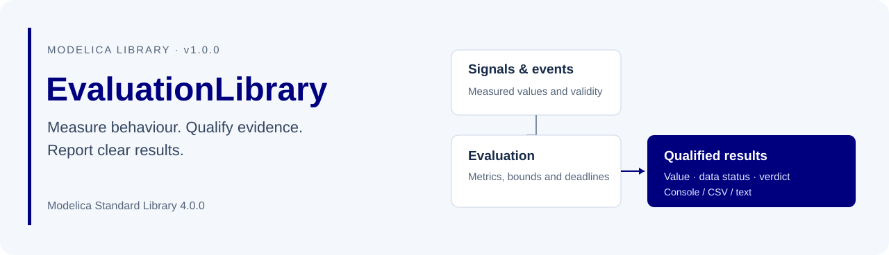
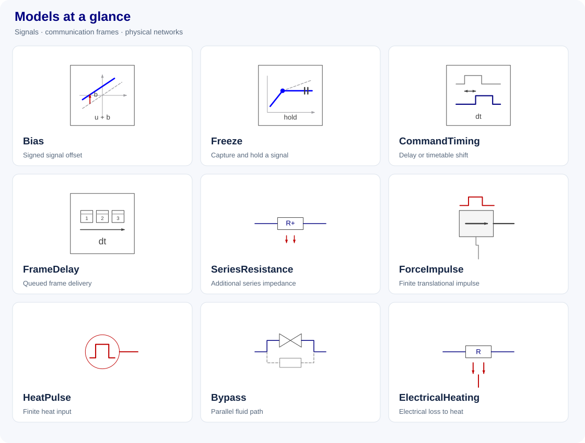

# AnomalyLibrary v1.0.0 — User Guide

English · [简体中文](UserGuide.zh-CN.md) · [Project overview](../README.md)

Installation, component selection, modelling exercises and the complete class reference.

## Contents

- [1. Library scope and structure](#1-library-scope-and-structure)
- [2. Load the library and run the first example](#2-load-the-library-and-run-the-first-example)
- [3. Configure activation and recovery](#3-configure-activation-and-recovery)
- [4. Build a signal disturbance](#4-build-a-signal-disturbance)
- [5. Work with communication frames](#5-work-with-communication-frames)
- [6. Insert a physical disturbance](#6-insert-a-physical-disturbance)
- [7. Choose and configure a component](#7-choose-and-configure-a-component)
- [8. Inspect effects and compare runs](#8-inspect-effects-and-compare-runs)
- [9. Complete class reference](#9-complete-class-reference)
- [10. Included examples](#10-included-examples)
- [11. Troubleshooting and modelling limits](#11-troubleshooting-and-modelling-limits)
- [12. Documentation and further reading](#12-documentation-and-further-reading)

## 1. Library scope and structure

AnomalyLibrary provides deterministic disturbances for Modelica simulations. Its **64 public components** cover signals, communication frames and physical networks. Nine examples illustrate their use; the complete source contains 95 Modelica classes, including packages, supporting blocks and in-tool guidance. The only library dependency is **Modelica Standard Library 4.0.0**.

Choose the connection according to the phenomenon. A signal block changes the value received downstream; a frame block changes delivery or metadata for identified messages; a physical component changes a network relation or applies a prescribed excitation. Set up a nominal case before introducing the selected disturbance.

| Package | Scope |
| --- | --- |
| [Signals](../Signals/package.mo) | Signal transformations and Boolean command disturbances. |
| [Communication](../Communication/package.mo) | Identified-frame delivery, timestamp changes and sampling-clock offsets. |
| [Electrical](../Electrical/package.mo) | Added loads, series voltage or resistance, leakage, ripple and supply sag. |
| [Mechanics](../Mechanics/package.mo) | Forces, torques, finite impulses, contact, coupling and release. |
| [Thermal](../Thermal/package.mo) | Heat flows, finite heat pulses and environmental heat exchange. |
| [Fluid](../Fluid/package.mo) | Resistance, bypass, injection, pressure ingress and vent paths. |
| [CrossDomain](../CrossDomain/package.mo) | Electrical heating, pressure-driven force and impact-related measurement bias. |
| [Utilities](../Utilities/package.mo) | Activation helpers, the finite frame queue, a teaching frame source and frame-policy types. |
| [Examples](../Examples/package.mo) | Nine self-contained models illustrating the public components. |
| [UsersGuide](../UsersGuide/package.mo) | Overview, getting started, conventions and limitations inside the modelling tool. |



## 2. Load the library and run the first example

1. Extract the archive and keep the `AnomalyLibrary` directory intact.
2. Load Modelica 4.0.0 in the modelling environment, then open `AnomalyLibrary/package.mo`. Avoid loading two copies of the same package name.
3. Open `AnomalyLibrary.Examples.SignalDeviationAndRecovery` and inspect its Diagram view.
4. Run its stored experiment: 0–4 s, output interval 0.008 s and tolerance `1e-6`.
5. Plot `ramp.y`, `biasValue`, `freezeValue` and `gainValue`. Also inspect the blocks' activation outputs.

The three disturbances use the same ramp and the interval `[1, 2)` s. The following values follow analytically from the supplied model definitions; compare them with your simulator output.

| Simulation instant | Ramp | Bias output | Frozen output | Gain-error output |
| --- | --- | --- | --- | --- |
| 0.5 s | 0.5 | 0.5 | 0.5 | 0.5 |
| 1.5 s | 1.5 | 3.5 | 1 | 3 |
| 2.5 s | 2.5 | 2.5 | 2.5 | 2.5 |

For OpenModelica, run these commands from the directory containing the `AnomalyLibrary` folder:

```modelica
loadModel(Modelica, {"4.0.0"});
loadFile("AnomalyLibrary/package.mo");
checkModel(AnomalyLibrary.Examples.SignalDeviationAndRecovery);
simulate(AnomalyLibrary.Examples.SignalDeviationAndRecovery,
  startTime=0, stopTime=4, numberOfIntervals=500,
  tolerance=1e-6);
getErrorString();
```

## 3. Configure activation and recovery

The library has two activation interfaces. Use the parameters declared by the selected component; their defaults are not uniform.

| Interface | Principal settings | Meaning |
| --- | --- | --- |
| Configurable activation | `enabled`, `startTime`, `endTime`, `severity`; optional `useExternalTrigger` and `trigger` | Most components in this family default to disabled. Activation requires `enabled=true` and `severity>0`. The request uses `[startTime, endTime)` unless `useExternalTrigger=true`, when `trigger` replaces the time window. |
| Fixed event window | `enabled`, `eventStartTime`, `eventEndTime` | A Boolean request on `[eventStartTime, eventEndTime)`, controlled by `enabled`. Configure the effect using the component's own magnitude and timing parameters. |

The fixed-event family includes `Signals.IntermittentLoss`, `NoiseInjection`, `PolarityReversal`, `SinusoidalInterference`, `Spike`, `Electrical.SwitchedCapacitiveLoad` and `Mechanics.VibrationForce`. Read each component's defaults and individual timing parameters.

For a ramped continuous disturbance, `active` indicates the requested interval and `effectLevel` gives the realised strength. With positive `transitionTime`, the effect starts from zero, rises towards `severity` and ramps back down after deactivation. The return ramp can extend beyond `endTime`. A reversal during a transition continues from the current level.

Discrete command and frame interventions that enforce binary severity accept only 0 or 1. A fractional value is not a probability of omission or delivery. `ForceImpulse`, `TorqueImpulse` and `HeatPulse` also require binary severity, fix `transitionTime=0` and derive `endTime=startTime+duration`.

Accepted pulse-like effects have their own completion rule. `CommandDuration`, `CommandSpurious` and command omission can retain an accepted action beyond the activation window. `ForceImpulse`, `TorqueImpulse` and `HeatPulse` start finite-duration rectangular pulses; a short trigger does not cancel an accepted pulse, while a subsequent activation restarts it. Inspect `effectActive` where it is exposed and read the component-specific recovery rule.

## 4. Build a signal disturbance

Save the following as a separate `FirstBias.mo`. The `within;` clause places it at the top level; adjust that clause if the model belongs to a named working package.

```modelica
within;
model FirstBias "Add a timed offset to a ramp signal"
  Modelica.Blocks.Sources.RealExpression ramp(y=time);
  AnomalyLibrary.Signals.Bias bias(
    enabled=true,
    startTime=1,
    endTime=2,
    transitionTime=0,
    severity=0.5,
    bias=2);
equation
  connect(ramp.y, bias.u);
  annotation(experiment(StartTime=0, StopTime=3,
    Interval=0.01, Tolerance=1e-6));
end FirstBias;
```

Plot `ramp.y`, `bias.y`, `bias.active`, `bias.effectLevel` and `bias.activationCount`. During `[1, 2)` s, the offset is `severity*bias = 1`, so the expected output at 1.5 s is 2.5. Before and after the interval, the output follows the ramp.

Set `transitionTime=0.1` and rerun to inspect the onset and recovery ramps. Then set `useExternalTrigger=true` and connect a Boolean source to `trigger` when the activation should be controlled by a measured condition. The internal start and end times no longer select activation in that configuration.

Use `Freeze` when the receiver should retain the value captured at activation. Use `Delay` for a causal real-signal delay. `CommandTiming` distinguishes a causal online Boolean delay from a signed shift of a known timetable; an unknown future input cannot be advanced. `NoiseInjection` accepts an externally supplied noise signal and does not generate random noise internally.

Signal-block order matters. For example, a frozen value captured after applying a bias can differ from a live bias applied after a freeze. Connect the nominal and modified paths so that their difference can be inspected directly.

## 5. Work with communication frames

Frame policies use a payload together with a transmission event counter and source metadata. `Communication.SampleClockOffset` has a separate sampled-signal interface; it is not a frame-queue policy.

| Input | Meaning |
| --- | --- |
| `u[nPayload]` | Payload associated with the candidate frame. |
| `txCount` | Transmission counter; each new frame must advance the previous count by exactly one. |
| `sequence` | Source-frame identity; this is distinct from the transmission counter. |
| `sourceTime` | Timestamp carried by the source frame. |
| `validIn` | Qualification attached to the incoming payload. |

The example below uses the internal teaching source already used by the supplied examples. In an application, connect the corresponding outputs of the actual producer.

```modelica
within;
model FirstFrameDelay "Observe delayed delivery of identified frames"
  AnomalyLibrary.Utilities.Internal.FrameSource transmitter(
    samplePeriod=0.1);
  AnomalyLibrary.Communication.FrameDelay channel(
    enabled=true,
    startTime=0,
    endTime=5,
    nPayload=1,
    samplePeriod=0.1,
    maxFrames=16,
    delayTime=0.2);
equation
  connect(transmitter.u, channel.u);
  connect(transmitter.txCount, channel.txCount);
  connect(transmitter.sequence, channel.sequence);
  connect(transmitter.sourceTime, channel.sourceTime);
  connect(transmitter.validIn, channel.validIn);
  annotation(experiment(StartTime=0, StopTime=4,
    Interval=0.008, Tolerance=1e-6));
end FirstFrameDelay;
```

Plot `transmitter.txCount`, `channel.rxCount`, `channel.receivedSequence`, `channel.receivedSourceTime` and `channel.queueLength`. A new reception is identified by a change in `rxCount`; an unchanged payload or repeated sequence identity can still be a new reception.

| Output | Interpretation |
| --- | --- |
| `available`, `validOut` | Availability and qualification of the retained payload; neither flag alone indicates a new arrival. |
| `rxCount` | Number of delivered frames, including repeated deliveries. |
| `receivedSequence`, `receivedSourceTime` | Identity and source timestamp retained from the delivered frame. |
| `queueLength`, `overflow` | Finite queue occupancy and capacity overflow. |
| `droppedCount` | Frames discarded by policy, capacity or recovery handling. |
| `inputSequenceError` | Invalid progression of `txCount`; the expected increment is one. |
| `serviceDelay` | Additional service-grid lateness beyond the frame's due time, not total end-to-end latency. |
| `noCachedFrame` | Replay has no qualifying cached frame. Interpret it together with the other output flags. |

While a frame policy is active, the queue releases at most one eligible frame per service tick. The service period and finite capacity must suit the source rate. When inactive, new frames are forwarded immediately. Deactivation discards pending and queued frames and accounts for them as drops.

Dropped frames generally leave the most recently received payload held at the output. `LinkOutage` masks availability while active. `FrameReplay` reuses the last valid frame cached while inactive, retaining that frame's identity and timestamp. `PayloadCorruption` changes the payload without automatically changing `validIn` into an invalid flag. `RateThrottle` selects frames from the global transmission count; its selection does not reset on each activation.

## 6. Insert a physical disturbance

A physical component must be connected according to its series, parallel or source role. The diagram topology is part of the model definition.

```modelica
within;
model FirstSeriesResistance "Insert a timed series resistance"
  Modelica.Electrical.Analog.Sources.ConstantVoltage supply(V=12);
  Modelica.Electrical.Analog.Basic.Ground ground;
  Modelica.Electrical.Analog.Basic.Resistor load(R=10);
  AnomalyLibrary.Electrical.SeriesResistance disturbance(
    enabled=true,
    startTime=1,
    endTime=2,
    transitionTime=0,
    R_add=5);
equation
  connect(supply.p, disturbance.p);
  connect(disturbance.n, load.p);
  connect(load.n, ground.p);
  connect(supply.n, ground.p);
  annotation(experiment(StartTime=0, StopTime=3,
    Interval=0.01, Tolerance=1e-6));
end FirstSeriesResistance;
```

The 12 V source supplies a 10 Ω load. Outside the disturbance interval, the added series voltage drop is zero and the expected load current is 1.2 A. With the 5 Ω addition fully active, the expected current is 0.8 A and the added-resistance loss is 3.2 W. Plot `load.i`, `disturbance.v`, `disturbance.lossPower` and `disturbance.effectLevel`.

When `useHeatPort=true`, connect `heatPort` to a thermal model. The electrical loss then leaves the component through the heat port. A thermal port must have an appropriate temperature relation through its connected network.

| Connection role | Typical components | Configuration point |
| --- | --- | --- |
| Series electrical path | `SeriesResistance`, `SeriesVoltage`, `SupplyRipple`, `VoltageSag` | Insert between two points in the existing path; observe pin orientation and voltage sign. |
| Parallel electrical path | `ShuntConductance`, `AddedLoad`, `ChassisLeakage` | Connect the branch across the intended nodes or chassis reference. |
| Mechanical excitation or contact | Force/torque sources, impulses, couplings, stops | Connect the appropriate translational or rotational flange and provide the required mechanical constraints. |
| Heat or environmental exchange | `HeatFlow`, `HeatPulse`, `AmbientShift`, `RadiativeExchange` | Use a thermal network with meaningful temperature and heat-capacity conditions. |
| Fluid path or boundary | `AddedResistance`, `Bypass`, `MassInjection`, `PressureIngress`, `Vent` | Select a compatible medium and connect physically meaningful pressure and flow boundaries. |

The zero-effect reference is model-specific. When `effectLevel=0`, `SeriesResistance` has zero voltage drop, `AmbientShift` retains conductance `G` to `referenceTemperature`, and `CompliantRelease` retains its nominal stiffness and damping. During recovery, `active` may be false before these reference relations are restored.

`PressureIngress` and `Vent` are reversible two-port resistive paths. Connect explicit boundaries to supply the pressure and thermodynamic state; neither component includes a pressure supply, environmental reservoir or one-way constraint. In `MassInjection`, `injectionPressure` determines the injected enthalpy and does not impose the fluid-port pressure.

## 7. Choose and configure a component

Select the model by the required connection and mathematical operation, then use the individual reference in section 9. State whether a value is a signed offset, a gain error, a finite impulse, a heat quantity or a frame policy parameter. Parameters with different physical meanings are not interchangeable.

- Keep units consistent along a signal path. Modelica connector types and the component's declared units provide the relevant convention; a numerical bias uses the same unit as its signal.
- For impulses, inspect both pulse duration and delivered impulse or heat. Shortening a pulse increases the applied amplitude for a fixed total quantity.
- For contact, stiffness and damping choices affect the dynamics and solver requirements. The finite regularised components are not rigid impact solvers.
- For fluid components, use the same compatible medium throughout the connected path and inspect the documented sign and flow-reversal assumptions.
- Cross-domain components represent specific couplings. Read whether the exchanged quantity is a conserving physical port or a prescribed signal before connecting it.



The previews are exported from existing Modelica `Icon` graphics. Instance labels are omitted; the Modelica icons and connector layouts remain unchanged.

## 8. Inspect effects and compare runs

Start with the nominal response and then enable one configured disturbance. Inspect the original signal or physical state, the modified response and the component's own activation outputs. For ramped effects that expose both outputs, compare `active` with `effectLevel`; for accepted command or impulse behaviour, also inspect the effect-specific flags or output waveform.

For frame models, inspect transmission and reception counts, source identity and timestamp, availability, validity and queue diagnostics together. A held value is not evidence that a frame arrived at the current instant. For physical models, inspect the appropriate current, force, torque, heat flow or mass flow as well as the resulting state.

Keep stimulus, initial conditions and solver settings consistent when comparing parameter choices. The library supplies deterministic disturbances; these signals do not by themselves establish a failure probability or a requirement verdict. Calculate any acceptance measure from the resulting model response using a clearly stated criterion.

## 9. Complete class reference

The following tables cover all **95 Modelica classes**. The 64 public components are in the seven domain packages. `Utilities` contains supporting implementation classes; `Examples` and `UsersGuide` provide executable demonstrations and in-tool documentation. Each name links to the corresponding source file.

The purpose and connection notes are concise selectors. Consult the class's parameter declarations and `Documentation` for exact equations, defaults and restrictions.

### 9.1 Library

| Class | Purpose | Use |
| --- | --- | --- |
| [`AnomalyLibrary`](../package.mo) | Deterministic disturbances in signals, communication frames and physical networks | Load Modelica 4.0.0, then open this package and select a component or example. |

### 9.2 Signals

| Class | Purpose | Use |
| --- | --- | --- |
| [`Signals`](../Signals/package.mo) | Real and Boolean signal anomalies | Insert a block between a signal source and receiver; select the activation interface exposed by that class. |
| [`Signals.Bias`](../Signals/Bias.mo) | Add a reversible offset to a real signal | Connect the nominal signal to u, use y downstream and set bias in the input unit. |
| [`Signals.BooleanFlip`](../Signals/BooleanFlip.mo) | Invert a Boolean signal during activation | Insert between a Boolean source and receiver; the inactive output equals u. |
| [`Signals.BooleanStuck`](../Signals/BooleanStuck.mo) | Force a configured Boolean value during activation | Set stuckValue and connect the nominal Boolean signal to u. |
| [`Signals.CommandDuration`](../Signals/CommandDuration.mo) | Replace accepted commands with pulses of a specified duration | Set nominalDuration and durationFactor; inspect effectActive separately from active. |
| [`Signals.CommandOmission`](../Signals/CommandOmission.mo) | Suppress commands accepted during activation | Connect the Boolean command and observe effectActive for the suppressed portion. |
| [`Signals.CommandSpurious`](../Signals/CommandSpurious.mo) | Add scheduled unintended Boolean pulses | Place extraTimes inside an active window and set pulseWidth; y is u OR the accepted pulses. |
| [`Signals.CommandTiming`](../Signals/CommandTiming.mo) | Delay an online command or shift a declared switching plan | Use delayTime for a live command, or useTimeTable with ordered timeTable and signedShift. |
| [`Signals.Deadband`](../Signals/Deadband.mo) | Apply a centred continuous deadband to a real signal | Set center and non-negative half-width width in the input unit. |
| [`Signals.Delay`](../Signals/Delay.mo) | Select a fixed history delay for a real signal | Set non-negative delayTime; the input is transmitted directly when inactive. |
| [`Signals.Drift`](../Signals/Drift.mo) | Add a bounded drift that restarts on each activation | Set driftRate in input units per second and maxAbsDrift in input units. |
| [`Signals.Dropout`](../Signals/Dropout.mo) | Replace an unavailable signal with an explicit fallback | Set fallbackValue and use valid to distinguish the fallback from a transmitted input. |
| [`Signals.Freeze`](../Signals/Freeze.mo) | Hold the input captured at an activation onset | Connect u and inspect held; each new activation captures a fresh value. |
| [`Signals.GainError`](../Signals/GainError.mo) | Apply a reversible relative gain error | Set the dimensionless gainError; y=(1+effectLevel*gainError)*u. |
| [`Signals.IntermittentLoss`](../Signals/IntermittentLoss.mo) | Apply periodic dropout intervals to a real signal | Set period, lossFraction and fallback; monitor valid alongside y. |
| [`Signals.NoiseInjection`](../Signals/NoiseInjection.mo) | Add an externally supplied disturbance to a real signal | Connect a disturbance sequence to noise and set its dimensionless gain. |
| [`Signals.PolarityReversal`](../Signals/PolarityReversal.mo) | Reverse the sign of a real signal within an event window | Connect the nominal real signal to u and configure the event window. |
| [`Signals.Quantization`](../Signals/Quantization.mo) | Quantise a real signal with half steps rounded away from zero | Set a strictly positive quantisation step q in the input unit. |
| [`Signals.RateLimit`](../Signals/RateLimit.mo) | Limit the output slope during activation | Set riseRate, fallRate and a positive trackingTime; inspect recovery discontinuities separately. |
| [`Signals.Saturation`](../Signals/Saturation.mo) | Blend a real signal towards configured saturation limits | Set ordered lower and upper limits; full clipping requires effectLevel=1. |
| [`Signals.SinusoidalInterference`](../Signals/SinusoidalInterference.mo) | Add sinusoidal interference within an event window | Set amplitude, frequency and phase; phase is referenced to eventStartTime. |
| [`Signals.Spike`](../Signals/Spike.mo) | Add a triangular pulse over a specified event window | Use eventStartTime and eventEndTime as the pulse endpoints and amplitude as the signed midpoint peak. |

### 9.3 Communication

| Class | Purpose | Use |
| --- | --- | --- |
| [`Communication`](../Communication/package.mo) | Deterministic frame and sampling anomalies | Bind the complete frame input set for frame blocks; SampleClockOffset instead samples a real array. |
| [`Communication.FrameDelay`](../Communication/FrameDelay.mo) | Delay frame delivery through a finite service queue | Bind all five frame inputs, increment txCount once per frame, and inspect rxCount, available and validOut. Set delayTime and samplePeriod for the requested delay and service grid. |
| [`Communication.FrameDropout`](../Communication/FrameDropout.mo) | Discard selected transmitted frames deterministically | Bind all five frame inputs, increment txCount once per frame, and inspect rxCount, available and validOut. Use dropSequences for source identities, or dropEveryN with an empty list. |
| [`Communication.FrameDuplicate`](../Communication/FrameDuplicate.mo) | Duplicate selected frames while retaining their source identity | Bind all five frame inputs, increment txCount once per frame, and inspect rxCount, available and validOut. Set duplicateEveryN; the two copies require separate service ticks. |
| [`Communication.FrameReorder`](../Communication/FrameReorder.mo) | Reverse adjacent valid frame pairs with a finite wait for a partner | Bind all five frame inputs, increment txCount once per frame, and inspect rxCount, available and validOut. Use maxFrames>=2 and pairTimeout for an unmatched first frame. |
| [`Communication.FrameReplay`](../Communication/FrameReplay.mo) | Replay the last valid frame received outside activation | Bind all five frame inputs, increment txCount once per frame, and inspect rxCount, available and validOut. Supply a valid inactive frame before replay; inspect noCachedFrame. |
| [`Communication.LinkOutage`](../Communication/LinkOutage.mo) | Suppress frame arrivals and mask output availability | Bind all five frame inputs, increment txCount once per frame, and inspect rxCount, available and validOut. Use available rather than the held payload to detect the outage. |
| [`Communication.PayloadCorruption`](../Communication/PayloadCorruption.mo) | Alter one payload channel using an affine transformation | Bind all five frame inputs, increment txCount once per frame, and inspect rxCount, available and validOut. Set payloadIndex, gain and offset in the channel unit. |
| [`Communication.RateThrottle`](../Communication/RateThrottle.mo) | Accept a deterministic subset of transmitted frames | Bind all five frame inputs, increment txCount once per frame, and inspect rxCount, available and validOut. Set acceptEveryN; selection is referenced to the global transmission count. |
| [`Communication.SampleClockOffset`](../Communication/SampleClockOffset.mo) | Switch between nominal and phase-shifted sampling grids | Connect u and configure sampleStart, samplePeriod and offset; read rxCount for sampling events. |
| [`Communication.TimestampOffset`](../Communication/TimestampOffset.mo) | Offset source timestamps carried by received frames | Bind all five frame inputs, increment txCount once per frame, and inspect rxCount, available and validOut. Set timeOffset; the payload and source identity are retained. |

### 9.4 Electrical

| Class | Purpose | Use |
| --- | --- | --- |
| [`Electrical`](../Electrical/package.mo) | Electrical circuit disturbances | Package overview and contents. |
| [`Electrical.AddedLoad`](../Electrical/AddedLoad.mo) | Regularised constant-power load | Connect p and n across a supply and set Pload and a positive Vregularization. |
| [`Electrical.ChassisLeakage`](../Electrical/ChassisLeakage.mo) | Additional conductance to a chassis connection | Connect p to the affected node and chassis to the intended electrical return. |
| [`Electrical.ParallelCurrent`](../Electrical/ParallelCurrent.mo) | Prescribed additional current source | Connect the source as a parallel branch; positive current injects into the system at p. |
| [`Electrical.SeriesResistance`](../Electrical/SeriesResistance.mo) | Additional series resistance with optional heat transfer | Insert p and n in series; enable useHeatPort to connect the dissipation to a thermal network. |
| [`Electrical.SeriesVoltage`](../Electrical/SeriesVoltage.mo) | Prescribed series voltage disturbance | Insert p and n in series and choose the sign of voltage for the required voltage drop. |
| [`Electrical.ShuntConductance`](../Electrical/ShuntConductance.mo) | Additional parallel conductance | Connect p and n across the affected nodes and set the full-effect conductance G_fault. |
| [`Electrical.SupplyRipple`](../Electrical/SupplyRipple.mo) | Sinusoidal series voltage disturbance | Insert the source in series and set amplitude, frequency and phase. |
| [`Electrical.SwitchedCapacitiveLoad`](../Electrical/SwitchedCapacitiveLoad.mo) | Capacitive load connected through a finite resistance | Connect p and n across a bus; set C, R, initialVoltage and the event interval. |
| [`Electrical.VoltageSag`](../Electrical/VoltageSag.mo) | Series voltage drop proportional to an independent reference | Insert p and n in series and supply an independent nominal voltage to vReference. |

### 9.5 Mechanics

| Class | Purpose | Use |
| --- | --- | --- |
| [`Mechanics`](../Mechanics/package.mo) | Mechanical loads and compliant connections | Package overview and contents. |
| [`Mechanics.BacklashContact`](../Mechanics/BacklashContact.mo) | Symmetric compliant contact with a displacement gap | Connect the two translational flanges and set the half-gap, contact stiffness and damping. |
| [`Mechanics.CompliantRelease`](../Mechanics/CompliantRelease.mo) | Reduction of a rotational connection to residual stiffness and damping | Use the model as the nominal flexible connection, then set residualK and residualD for release. |
| [`Mechanics.ForceImpulse`](../Mechanics/ForceImpulse.mo) | Rectangular force pulse with a specified impulse | Connect flange to the driven body, set impulse and duration, and expose support when needed. Set enabled=true and choose startTime or an external trigger. |
| [`Mechanics.InertialLoad`](../Mechanics/InertialLoad.mo) | Equivalent force from a prescribed frame acceleration | Supply acceleration, set mReference and connect the translational flange and optional support. |
| [`Mechanics.RotationalTorque`](../Mechanics/RotationalTorque.mo) | Prescribed external torque disturbance | Connect flange to the driven shaft and enable useSupport when its reaction must be modelled. |
| [`Mechanics.RotationalViscousCoupling`](../Mechanics/RotationalViscousCoupling.mo) | Additional rotational viscous coupling | Connect the two rotational flanges and set the damping coefficient d. |
| [`Mechanics.TorqueImpulse`](../Mechanics/TorqueImpulse.mo) | Rectangular torque pulse with a specified angular impulse | Connect flange to the driven shaft, set angularImpulse and duration, and expose support when needed. Set enabled=true and choose startTime or an external trigger. |
| [`Mechanics.TranslationalForce`](../Mechanics/TranslationalForce.mo) | Prescribed external force disturbance | Connect flange to the driven body and enable useSupport when its reaction must be modelled. |
| [`Mechanics.TranslationalViscousCoupling`](../Mechanics/TranslationalViscousCoupling.mo) | Additional translational viscous coupling | Connect the two translational flanges and set the damping coefficient d. |
| [`Mechanics.UnilateralStop`](../Mechanics/UnilateralStop.mo) | Compliant stop at a one-sided displacement limit | Connect the two translational flanges and set the positive relative-displacement limit gap. |
| [`Mechanics.VibrationForce`](../Mechanics/VibrationForce.mo) | Sinusoidal external force during a scheduled interval | Connect flange to a translational body and set amplitude, frequency and the event interval. |

### 9.6 Thermal

| Class | Purpose | Use |
| --- | --- | --- |
| [`Thermal`](../Thermal/package.mo) | Thermal sources and additional heat-transfer paths | Package overview and contents. |
| [`Thermal.AddedConductance`](../Thermal/AddedConductance.mo) | Additional thermal conductance between two ports | Connect port_a and port_b to the two thermal nodes and set G. |
| [`Thermal.AmbientShift`](../Thermal/AmbientShift.mo) | Environment temperature shift through a finite conductance | Connect port to the body and configure the nominal environment temperature, deltaT and G. |
| [`Thermal.HeatFlow`](../Thermal/HeatFlow.mo) | Prescribed heat-flow disturbance with an energy integral | Connect port to a thermal node and set the signed heat-flow parameter Q. |
| [`Thermal.HeatPulse`](../Thermal/HeatPulse.mo) | Rectangular heat-flow pulse with a specified energy | Connect port to a thermal node and set energy and a positive duration. Set enabled=true and choose startTime or an external trigger. |
| [`Thermal.RadiativeExchange`](../Thermal/RadiativeExchange.mo) | Radiative heat exchange with a prescribed environment | Connect port to the radiating body and set its area, emissivity and environment temperature. |

### 9.7 Fluid

| Class | Purpose | Use |
| --- | --- | --- |
| [`Fluid`](../Fluid/package.mo) | Additional fluid paths and prescribed mass exchange | Package overview and contents. |
| [`Fluid.AddedResistance`](../Fluid/AddedResistance.mo) | Additional linear series pressure-drop resistance | Insert port_a and port_b in series and redeclare Medium consistently with the connected network. |
| [`Fluid.Bypass`](../Fluid/Bypass.mo) | Additional reversible linear bypass path | Connect port_a and port_b across the intended bypass endpoints using a common Medium. |
| [`Fluid.MassInjection`](../Fluid/MassInjection.mo) | Prescribed fluid injection or withdrawal | Connect port to the fluid network, match Medium and specify injection and the injected state. |
| [`Fluid.PressureIngress`](../Fluid/PressureIngress.mo) | Finite flow path to an explicitly connected pressure supply | Connect port_a to the supply and port_b to the affected network; match Medium on both sides. |
| [`Fluid.Vent`](../Fluid/Vent.mo) | Finite vent path to an explicitly connected environment | Connect port_a to the affected network and port_b to an environmental boundary with the same Medium. |

### 9.8 CrossDomain

| Class | Purpose | Use |
| --- | --- | --- |
| [`CrossDomain`](../CrossDomain/package.mo) | Coupled disturbances across physical domains | Package overview and contents. |
| [`CrossDomain.ElectricalHeating`](../CrossDomain/ElectricalHeating.mo) | Additional electrical dissipation transferred to a thermal port | Connect p and n as a parallel branch and connect heatPort to the receiving thermal network. |
| [`CrossDomain.ImpactMeasurementBias`](../CrossDomain/ImpactMeasurementBias.mo) | Filtered shock contribution to a measurement bias | Connect the original measurement to u and the shock signal to shock; take the disturbed measurement from y. |
| [`CrossDomain.PressureForce`](../CrossDomain/PressureForce.mo) | External force from a prescribed pressure difference | Supply dp, set the effective area A and connect the translational flange and optional support. |

### 9.9 Utilities

| Class | Purpose | Use |
| --- | --- | --- |
| [`Utilities`](../Utilities/package.mo) | Shared types and implementation helpers | Package overview and contents. |
| [`Utilities.Internal`](../Utilities/Internal/package.mo) | Internal activation and frame-processing helpers | Package overview and contents. |
| [`Utilities.Types`](../Utilities/Types/package.mo) | Types for deterministic frame processing | Package overview and contents. |
| [`Utilities.Internal.Activation`](../Utilities/Internal/Activation.mo) | Generate a reversible activation level with optional latching | Connect externalTrigger when using external activation; otherwise bind it and configure the internal interval. Read active separately from the ramped effectLevel. |
| [`Utilities.Internal.EventActivation`](../Utilities/Internal/EventActivation.mo) | Activate within a half-open event interval | Set enabled and the event boundaries, then use active as a Boolean condition. |
| [`Utilities.Internal.FrameQueue`](../Utilities/Internal/FrameQueue.mo) | Apply a deterministic policy to a finite frame queue | Bind all payload, counter, metadata, validity and activation inputs. Choose a positive service period and queue capacity; observe rxCount and qualification flags alongside the held output. |
| [`Utilities.Internal.FrameSource`](../Utilities/Internal/FrameSource.mo) | Generate one-field frames on a uniform sample clock | Connect u, txCount, sequence, sourceTime and validIn to a frame-processing block with a compatible service period. |
| [`Utilities.Types.FrameMode`](../Utilities/Types/FrameMode.mo) | Deterministic frame-processing policy | Set the FrameQueue mode parameter to the required policy. |

### 9.10 Examples

| Class | Purpose | Use |
| --- | --- | --- |
| [`Examples`](../Examples/package.mo) | Self-contained examples of anomaly components | Package overview and contents. |
| [`Examples.CombinedAnomalies`](../Examples/CombinedAnomalies.mo) | Compare a serial anomaly path with the unmodified signal | Run the stored experiment and plot nominal and modified, then inspect offset, delay and hold individually. |
| [`Examples.CrossDomainEffects`](../Examples/CrossDomainEffects.mo) | Transfer electrical dissipation to heat and pressure to force | Run the stored experiment and compare electrical loss with the thermal temperature slope and the prescribed force. |
| [`Examples.DeterministicCommunication`](../Examples/DeterministicCommunication.mo) | Compare dropping, delay, reordering and duplication of frames | Use the stored experiment and inspect delivery counters alongside received sequence identifiers and queue lengths. |
| [`Examples.ElectricalDisturbances`](../Examples/ElectricalDisturbances.mo) | Compare a parallel conductance with a series voltage ripple | Run the stored experiment and inspect the shunt current and the independent ripple loop. |
| [`Examples.FluidPathDisturbances`](../Examples/FluidPathDisturbances.mo) | Open a parallel fluid path between prescribed boundaries | Simulate with reverse=false, then reverse=true, and compare the two path flows. |
| [`Examples.MechanicalImpulseAndContact`](../Examples/MechanicalImpulseAndContact.mo) | Compare finite impulses with a unilateral mechanical stop | Plot the two free-body velocity changes and the reaction of the independently driven contact body. |
| [`Examples.SignalDeviationAndRecovery`](../Examples/SignalDeviationAndRecovery.mo) | Compare bias, capture and gain on a shared ramp | Use this first example to inspect nominal, active and recovered signal values. |
| [`Examples.ThermalPulseAndEnvironment`](../Examples/ThermalPulseAndEnvironment.mo) | Compare a heat pulse with conductive and radiative environments | Compare the isolated pulse energy balance with the two separate environment-driven temperature responses. |
| [`Examples.UnsafeCommandPatterns`](../Examples/UnsafeCommandPatterns.mo) | Compare omitted, spurious, delayed and duration-modified commands | Run the stored experiment and compare all output edges and pulse durations with the original command. |

### 9.11 UsersGuide

| Class | Purpose | Use |
| --- | --- | --- |
| [`UsersGuide`](../UsersGuide/package.mo) | User's guide | Package overview and contents. |
| [`UsersGuide.Conventions`](../UsersGuide/Conventions.mo) | Activation, interfaces and observable quantities | Check activation and validity flags together with the component-specific effect quantities. |
| [`UsersGuide.GettingStarted`](../UsersGuide/GettingStarted.mo) | Load the library and run a first example | Open Examples.SignalDeviationAndRecovery and use the stored experiment to inspect nominal, active and recovered behaviour. |
| [`UsersGuide.Limitations`](../UsersGuide/Limitations.mo) | Modelling assumptions and numerical limits | Review queue capacity, activation discontinuities and the physical boundary assumptions before applying a component. |
| [`UsersGuide.Overview`](../UsersGuide/Overview.mo) | Library scope and package organisation | Use the package groups to choose the relevant signal or physical interface before selecting a component. |

## 10. Included examples

All nine examples include their own sources and connections. Run the stored experiment settings and inspect the quantities named below. The models demonstrate configured mechanisms; expected values in the documentation are derived from their equations.

| Example | Simulation interval | What to inspect |
| --- | --- | --- |
| [`Examples.CombinedAnomalies`](../Examples/CombinedAnomalies.mo) | 0–6 s | Run the stored experiment and plot nominal and modified, then inspect offset, delay and hold individually. |
| [`Examples.CrossDomainEffects`](../Examples/CrossDomainEffects.mo) | 0–5 s | Run the stored experiment and compare electrical loss with the thermal temperature slope and the prescribed force. |
| [`Examples.DeterministicCommunication`](../Examples/DeterministicCommunication.mo) | 0–4 s | Use the stored experiment and inspect delivery counters alongside received sequence identifiers and queue lengths. |
| [`Examples.ElectricalDisturbances`](../Examples/ElectricalDisturbances.mo) | 0–4 s | Run the stored experiment and inspect the shunt current and the independent ripple loop. |
| [`Examples.FluidPathDisturbances`](../Examples/FluidPathDisturbances.mo) | 0–5 s | Simulate with reverse=false, then reverse=true, and compare the two path flows. |
| [`Examples.MechanicalImpulseAndContact`](../Examples/MechanicalImpulseAndContact.mo) | 0–5 s | Plot the two free-body velocity changes and the reaction of the independently driven contact body. |
| [`Examples.SignalDeviationAndRecovery`](../Examples/SignalDeviationAndRecovery.mo) | 0–4 s | Use this first example to inspect nominal, active and recovered signal values. |
| [`Examples.ThermalPulseAndEnvironment`](../Examples/ThermalPulseAndEnvironment.mo) | 0–5 s | Compare the isolated pulse energy balance with the two separate environment-driven temperature responses. |
| [`Examples.UnsafeCommandPatterns`](../Examples/UnsafeCommandPatterns.mo) | 0–4 s | Run the stored experiment and compare all output edges and pulse durations with the original command. |

## 11. Troubleshooting and modelling limits

| Observation | Check |
| --- | --- |
| No visible effect | Check `enabled`, the component's actual time-window parameter names, external trigger selection and the effect-specific magnitude. |
| Effect continues after deactivation | Inspect the recovery ramp or accepted-pulse/command semantics; `active` need not equal the realised effect state. |
| Noise is constant | `NoiseInjection` uses the connected external noise signal; inspect that input. |
| A frame payload remains unchanged | Inspect `rxCount`, availability, validity and frame identity; a repeated value does not identify delivery. |
| Frame losses or an increasing queue | Compare transmission rate with the service grid, selected policy and `maxFrames`; inspect overflow and dropped counts. |
| A counter error is reported | Advance `txCount` by exactly one for each candidate frame. Source sequence identity is a separate field. |
| Physical spikes or difficult integration | Inspect connection topology, initial conditions, source constraints, impulse duration, contact stiffness and transition settings. |

The components are deterministic mechanism models. Their parameters and physical simplifications must be suitable for the connected system. Finite service queues are not a complete communication stack, and a given frame policy does not provide a stochastic network distribution. Cross-domain models implement only their stated coupling. Recheck the examples in the Modelica environment used for an application, especially after changing solver and event-handling settings.

## 12. Documentation and further reading

- [English project overview](../README.md) / [中文项目说明](../README.zh-CN.md)
- [In-tool User's Guide](../UsersGuide/package.mo)
- [Root package](../package.mo)
- [Buildings Library User Guide — Getting Started](https://simulationresearch.lbl.gov/modelica/userGuide/gettingStarted.html)
- [Buildings — SimpleHouse step-by-step tutorial](https://simulationresearch.lbl.gov/modelica/releases/v11.1.2/help/Buildings_Examples_Tutorial_SimpleHouse.html)
- [Modelica documentation conventions](https://doc.modelica.org/Modelica%204.0.0/Resources/helpDymola/Modelica_UsersGuide_Conventions_Documentation.html)
- [Licence: GNU General Public License v3](../LICENSE)
