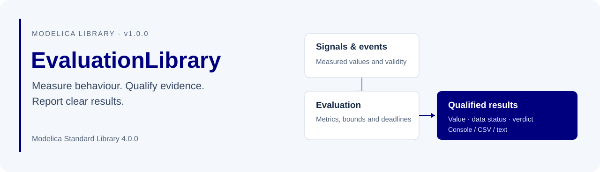
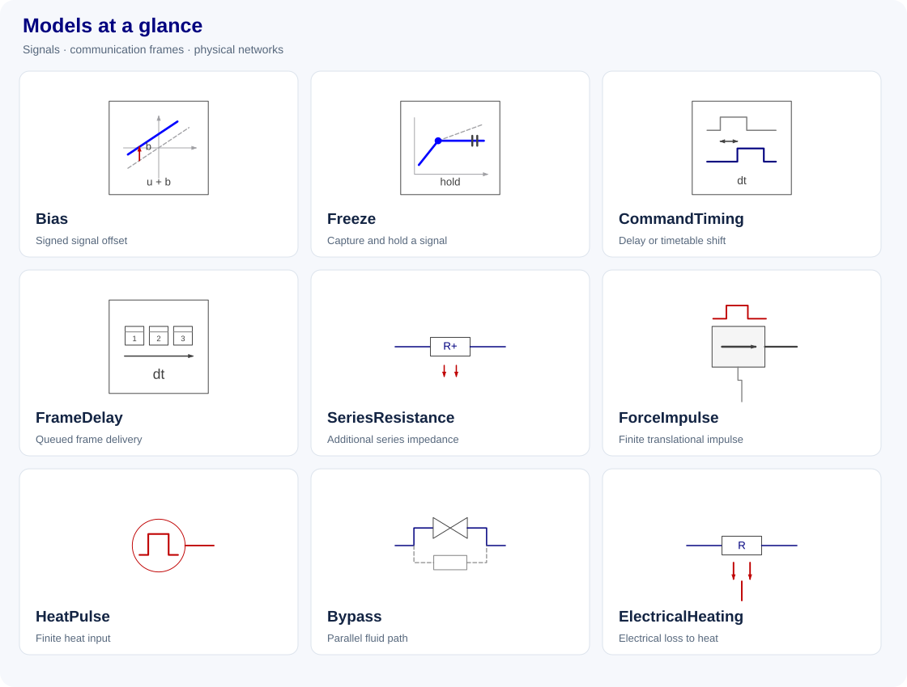

# AnomalyLibrary v1.0.0 使用手册

[English](UserGuide.md) · 简体中文 · [项目说明](../README.zh-CN.md)

介绍安装、元件选型、建模练习与全部类的使用参考。类名、参数名和代码保持英文。

## 目录

- [1. 库的用途与结构](#1-库的用途与结构)
- [2. 加载库并运行首个示例](#2-加载库并运行首个示例)
- [3. 配置激活与恢复](#3-配置激活与恢复)
- [4. 建立信号扰动模型](#4-建立信号扰动模型)
- [5. 使用通信报文模型](#5-使用通信报文模型)
- [6. 接入物理扰动元件](#6-接入物理扰动元件)
- [7. 选择并配置元件](#7-选择并配置元件)
- [8. 观察效果并比较仿真](#8-观察效果并比较仿真)
- [9. 完整类参考](#9-完整类参考)
- [10. 自带示例](#10-自带示例)
- [11. 排错与建模边界](#11-排错与建模边界)
- [12. 文档与延伸阅读](#12-文档与延伸阅读)

## 1. 库的用途与结构

AnomalyLibrary 用于在 Modelica 仿真中建立确定性扰动。**64 个公开元件**覆盖信号、通信报文与物理网络，配有 9 个示例。源码共含 95 个 Modelica 类，包括包、支撑模块和工具内说明。唯一库依赖为 **Modelica Standard Library 4.0.0**。

根据现象选择连接方式：信号模块改变下游接收到的数值，报文模块改变带标识消息的交付或元数据，物理元件改变网络关系或施加规定激励。引入扰动前，先建立可以对照的正常工况。

| 包 | 主要内容 |
| --- | --- |
| [Signals](../Signals/package.mo) | 信号变换与布尔命令扰动。 |
| [Communication](../Communication/package.mo) | 带标识报文的交付、时间戳修改与采样时钟偏移。 |
| [Electrical](../Electrical/package.mo) | 附加负载、串联电压或电阻、漏电、纹波与电压跌落。 |
| [Mechanics](../Mechanics/package.mo) | 力、力矩、有限冲量、接触、耦合与释放。 |
| [Thermal](../Thermal/package.mo) | 热流、有限热量脉冲及环境换热。 |
| [Fluid](../Fluid/package.mo) | 阻力、旁路、质量注入、压力侵入与泄放通路。 |
| [CrossDomain](../CrossDomain/package.mo) | 电气发热、压差作用力与冲击引起的测量偏差。 |
| [Utilities](../Utilities/package.mo) | 激活辅助模块、有限报文队列、教学报文源及策略类型。 |
| [Examples](../Examples/package.mo) | 9 个自包含示例，用于学习公开元件。 |
| [UsersGuide](../UsersGuide/package.mo) | 建模工具内的概述、入门、约定与使用边界。 |



## 2. 加载库并运行首个示例

1. 解压压缩包，保留完整的 `AnomalyLibrary` 目录。
2. 在建模环境中加载 Modelica 4.0.0，再打开 `AnomalyLibrary/package.mo`，避免同时加载同名库的两个副本。
3. 打开 `AnomalyLibrary.Examples.SignalDeviationAndRecovery` 并查看 Diagram 图。
4. 使用自带实验设置运行：0–4 s、输出间隔 0.008 s、容差 `1e-6`。
5. 绘制 `ramp.y`、`biasValue`、`freezeValue` 和 `gainValue`，同时查看各模块的激活输出。

三个扰动共用同一斜坡信号，作用区间为 `[1, 2)` s。下表由模型定义推导，可用于对照实际仿真结果。

| 仿真时刻 | 斜坡输入 | 偏置输出 | 冻结输出 | 增益误差输出 |
| --- | --- | --- | --- | --- |
| 0.5 s | 0.5 | 0.5 | 0.5 | 0.5 |
| 1.5 s | 1.5 | 3.5 | 1 | 3 |
| 2.5 s | 2.5 | 2.5 | 2.5 | 2.5 |

使用 OpenModelica 时，在包含 `AnomalyLibrary` 文件夹的上级目录中执行：

```modelica
loadModel(Modelica, {"4.0.0"});
loadFile("AnomalyLibrary/package.mo");
checkModel(AnomalyLibrary.Examples.SignalDeviationAndRecovery);
simulate(AnomalyLibrary.Examples.SignalDeviationAndRecovery,
  startTime=0, stopTime=4, numberOfIntervals=500,
  tolerance=1e-6);
getErrorString();
```

## 3. 配置激活与恢复

库中存在两套激活接口，应使用所选元件实际声明的参数；不同元件的默认值并不统一。

| 接口形式 | 主要设置 | 含义 |
| --- | --- | --- |
| 可配置激活 | `enabled`、`startTime`、`endTime`、`severity`；可选 `useExternalTrigger` 与 `trigger` | 该类多数元件默认关闭。激活要求 `enabled=true` 且 `severity>0`。请求采用 `[startTime, endTime)`；设置 `useExternalTrigger=true` 时，由 `trigger` 替代该时间窗。 |
| 固定事件窗 | `enabled`、`eventStartTime`、`eventEndTime` | 由 `enabled` 控制的布尔型半开窗口 `[eventStartTime, eventEndTime)`。效果通过元件自身的幅值和时间参数配置。 |

固定事件窗类包括 `Signals.IntermittentLoss`、`NoiseInjection`、`PolarityReversal`、`SinusoidalInterference`、`Spike`、`Electrical.SwitchedCapacitiveLoad` 和 `Mechanics.VibrationForce`。使用前应查看各自默认值与时间参数。

对于渐变型连续扰动，`active` 表示请求处于激活状态，`effectLevel` 表示实际作用强度。`transitionTime` 为正时，效果从零逐渐升至 `severity`，取消激活后再逐渐回落，因此恢复过程可能延续到 `endTime` 之后。过渡途中反向切换时，从当前强度继续变化。

要求二值强度的离散命令和报文元件仅接受 0 或 1，小数强度不代表遗漏或交付概率。`ForceImpulse`、`TorqueImpulse` 和 `HeatPulse` 同样要求二值强度，并固定 `transitionTime=0`，由 `endTime=startTime+duration` 确定结束时刻。

已接受的脉冲或命令具有各自的结束规则。`CommandDuration`、`CommandSpurious` 和命令遗漏可能在激活窗关闭后继续执行已经接受的动作。`ForceImpulse`、`TorqueImpulse` 和 `HeatPulse` 在激活时开始有限时长矩形脉冲；缩短触发信号不会取消已开始的脉冲，后续新激活会重新开始计时。若模型提供 `effectActive`，应结合该输出和各自恢复规则判断效果是否结束。

## 4. 建立信号扰动模型

将以下代码保存为独立的 `FirstBias.mo`。`within;` 表示顶层模型；若放入命名工作包，应修改为对应的包名。

```modelica
within;
model FirstBias "Add a timed offset to a ramp signal"
  Modelica.Blocks.Sources.RealExpression ramp(y=time);
  AnomalyLibrary.Signals.Bias bias(
    enabled=true,
    startTime=1,
    endTime=2,
    transitionTime=0,
    severity=0.5,
    bias=2);
equation
  connect(ramp.y, bias.u);
  annotation(experiment(StartTime=0, StopTime=3,
    Interval=0.01, Tolerance=1e-6));
end FirstBias;
```

绘制 `ramp.y`、`bias.y`、`bias.active`、`bias.effectLevel` 和 `bias.activationCount`。在 `[1, 2)` s 内，偏移量为 `severity*bias = 1`，因此 1.5 s 时预期输出为 2.5；在窗口前后，输出跟随斜坡输入。

将 `transitionTime` 改为 0.1 s 后重新运行，可查看渐变激活与恢复。若希望由观测条件控制激活，设置 `useExternalTrigger=true` 并向 `trigger` 连接布尔源；此时内部起止时刻不再决定激活区间。

需要保持激活时刻采集到的输入时，选用 `Freeze`；实数信号的因果延迟可选用 `Delay`。`CommandTiming` 区分在线布尔延迟与已知时刻表的有符号平移，不能提前获得未知的未来输入。`NoiseInjection` 接收外部噪声信号，不在内部生成随机过程。

信号模块的串联顺序会影响结果。例如先加偏置再冻结，与先冻结再施加实时偏置，可能得到不同输出。保留可直接比较的正常路径和扰动路径。

## 5. 使用通信报文模型

报文策略同时使用载荷、发送事件计数器和源元数据。`Communication.SampleClockOffset` 采用独立的采样信号接口，不属于报文队列策略。

| 输入 | 含义 |
| --- | --- |
| `u[nPayload]` | 当前候选报文的载荷。 |
| `txCount` | 发送计数器；每个新报文必须相对前值恰好增加 1。 |
| `sequence` | 源报文标识，与发送计数器分别表示不同含义。 |
| `sourceTime` | 源报文携带的时间戳。 |
| `validIn` | 输入载荷的有效性信息。 |

下面使用自带示例中已经采用的内部教学报文源。实际应用中，应连接真实报文产生端的对应输出。

```modelica
within;
model FirstFrameDelay "Observe delayed delivery of identified frames"
  AnomalyLibrary.Utilities.Internal.FrameSource transmitter(
    samplePeriod=0.1);
  AnomalyLibrary.Communication.FrameDelay channel(
    enabled=true,
    startTime=0,
    endTime=5,
    nPayload=1,
    samplePeriod=0.1,
    maxFrames=16,
    delayTime=0.2);
equation
  connect(transmitter.u, channel.u);
  connect(transmitter.txCount, channel.txCount);
  connect(transmitter.sequence, channel.sequence);
  connect(transmitter.sourceTime, channel.sourceTime);
  connect(transmitter.validIn, channel.validIn);
  annotation(experiment(StartTime=0, StopTime=4,
    Interval=0.008, Tolerance=1e-6));
end FirstFrameDelay;
```

绘制 `transmitter.txCount`、`channel.rxCount`、`channel.receivedSequence`、`channel.receivedSourceTime` 和 `channel.queueLength`。应通过 `rxCount` 的变化识别新接收事件；即使载荷数值或序列标识重复，也可能收到一帧新的交付。

| 输出 | 解读方式 |
| --- | --- |
| `available`、`validOut` | 保持在输出端的载荷是否可用、是否有效；单独读取任一标志都不能判断是否刚收到新帧。 |
| `rxCount` | 已交付帧数，包含重复交付。 |
| `receivedSequence`、`receivedSourceTime` | 已交付帧所携带的源标识和源时间戳。 |
| `queueLength`、`overflow` | 有限队列长度及容量溢出。 |
| `droppedCount` | 因策略、容量或恢复处理而丢弃的帧数。 |
| `inputSequenceError` | `txCount` 递增方式异常，期望每次恰好增加 1。 |
| `serviceDelay` | 超过该帧到期时刻的额外服务网格迟延，不是全部端到端延迟。 |
| `noCachedFrame` | 重放策略没有符合条件的缓存帧，应结合其他输出标志解读。 |

策略激活时，每个服务时刻最多释放一帧符合条件的报文，服务周期与有限容量需要匹配发送速率。未激活时，新报文即时转发。取消激活会清空仍在等待或排队的报文，并将其计入丢弃数量。

丢帧通常会继续保持最近一次已接收的载荷；`LinkOutage` 在激活时屏蔽可用标志。`FrameReplay` 重用未激活期间缓存的最后一个有效帧，并保留该帧原来的标识和时间戳。`PayloadCorruption` 改变载荷时不会自动将 `validIn` 转换为无效标志。`RateThrottle` 按全局发送计数选择报文，每次激活时不会重新开始该选择序列。

## 6. 接入物理扰动元件

物理元件必须按串联、并联或激励源的角色接入，图形中的连接拓扑本身就是模型定义的一部分。

```modelica
within;
model FirstSeriesResistance "Insert a timed series resistance"
  Modelica.Electrical.Analog.Sources.ConstantVoltage supply(V=12);
  Modelica.Electrical.Analog.Basic.Ground ground;
  Modelica.Electrical.Analog.Basic.Resistor load(R=10);
  AnomalyLibrary.Electrical.SeriesResistance disturbance(
    enabled=true,
    startTime=1,
    endTime=2,
    transitionTime=0,
    R_add=5);
equation
  connect(supply.p, disturbance.p);
  connect(disturbance.n, load.p);
  connect(load.n, ground.p);
  connect(supply.n, ground.p);
  annotation(experiment(StartTime=0, StopTime=3,
    Interval=0.01, Tolerance=1e-6));
end FirstSeriesResistance;
```

12 V 电源向 10 Ω 负载供电。扰动区间外，新增串联压降为零，预期负载电流为 1.2 A；5 Ω 附加电阻完全生效后，预期电流为 0.8 A，附加电阻损耗为 3.2 W。绘制 `load.i`、`disturbance.v`、`disturbance.lossPower` 和 `disturbance.effectLevel`。

设置 `useHeatPort=true` 时，应将 `heatPort` 连接到热网络，使电气损耗经该热端口传出；所连网络需要给出合理的温度关系。

| 接入角色 | 典型元件 | 配置要点 |
| --- | --- | --- |
| 串联电气通路 | `SeriesResistance`、`SeriesVoltage`、`SupplyRipple`、`VoltageSag` | 插入原通路的两个节点之间，注意引脚方向和电压正负号。 |
| 并联电气通路 | `ShuntConductance`、`AddedLoad`、`ChassisLeakage` | 将支路接在预期节点或机壳参考节点之间。 |
| 机械激励或接触 | 力/力矩源、冲量、耦合和限位 | 使用对应的平动或转动法兰，提供所需机械约束。 |
| 热量或环境换热 | `HeatFlow`、`HeatPulse`、`AmbientShift`、`RadiativeExchange` | 接入具有明确温度和热容量条件的热网络。 |
| 流体通路或边界 | `AddedResistance`、`Bypass`、`MassInjection`、`PressureIngress`、`Vent` | 选择兼容介质，并连接具有物理意义的压力与流动边界。 |

零效果下的基准关系取决于具体模型。`effectLevel=0` 时，`SeriesResistance` 的附加压降为零，`AmbientShift` 保留通向 `referenceTemperature` 的热导 `G`，`CompliantRelease` 保留名义刚度和阻尼。恢复过程中，`active` 可能已为 false，但元件尚未完全回到上述基准关系。

`PressureIngress` 和 `Vent` 是允许反向流动的双端口阻性通路。应连接显式边界以提供压力与热力状态；元件内部没有压力源、环境储槽或单向流动约束。`MassInjection` 中的 `injectionPressure` 用于计算注入焓，并不规定流体端口的压力。

## 7. 选择并配置元件

按所需连接方式和数学作用选择模型，再参考第 9 节的逐项说明。明确参数是有符号偏置、增益误差、有限冲量、热量还是报文策略参数，不同物理含义的数值不能直接互换。

- 信号路径应保持单位一致。以连接器类型和模型声明的单位为准；数值偏置与被处理信号使用相同单位。
- 对冲量模型同时检查脉冲持续时间和总冲量或总热量。总量固定时，缩短脉冲会提高施加幅值。
- 接触刚度与阻尼影响动力学和求解需求，有限柔性接触模型不等同于刚体碰撞求解器。
- 流体通路应采用相互兼容的介质定义，并检查流量正方向和反向流动假设。
- 跨领域元件只表示各自定义的耦合。连接前应区分守恒型物理端口和规定输入信号。



展示图由现有 Modelica `Icon` 图形导出，省略实例名；模型内部图标与连接器布局保持原样。

## 8. 观察效果并比较仿真

先查看正常响应，再启用一个已配置的扰动。共同观察原始信号或物理状态、修改后的响应，以及元件自身的激活输出。对于同时提供 `active` 和 `effectLevel` 的渐变效果，应比较这两个输出；对于已接受的命令或冲量，还应查看效果标志或输出波形。

报文模型应同时查看收发计数、源标识、源时间戳、可用性、有效性和队列诊断。输出保持某个数值，并不能证明当前时刻有新帧到达。物理模型还应观察相应的电流、力、力矩、热流或质量流量及其引起的状态变化。

比较不同配置时，保持激励、初始条件和求解设置一致。本库提供确定性扰动，这些信号本身不直接给出故障概率或要求判定；应基于模型响应和明确的判据计算所需接受指标。

## 9. 完整类参考

下表覆盖全部 **95 个 Modelica 类**。64 个公开元件分布在七个领域包中，`Utilities` 包含支撑实现，`Examples` 与 `UsersGuide` 提供可运行示例和工具内说明。每个名称均链接到对应源文件。

用途与接入说明用于快速选型，精确方程、默认值和限制应以模型参数声明及 `Documentation` 为准。

### 9.1 根包

| 类 | 用途 | 接入与使用 |
| --- | --- | --- |
| [`AnomalyLibrary`](../package.mo) | 信号、通信报文和物理网络的确定性扰动库。 | 加载 Modelica 4.0.0，再打开本包并选择元件或示例。 |

### 9.2 Signals

| 类 | 用途 | 接入与使用 |
| --- | --- | --- |
| [`Signals`](../Signals/package.mo) | 实数与布尔信号异常包。 | 将模型插入信号源与接收端之间，并按该类实际暴露的接口配置激活。 |
| [`Signals.Bias`](../Signals/Bias.mo) | 向实数信号叠加可恢复的偏置。 | 将名义信号接到 u，下游使用 y，并以输入量的单位设置 bias。 |
| [`Signals.BooleanFlip`](../Signals/BooleanFlip.mo) | 在激活期间反转布尔信号。 | 插入布尔信号源与接收端之间，未激活时 y 等于 u。 |
| [`Signals.BooleanStuck`](../Signals/BooleanStuck.mo) | 在激活期间强制输出指定布尔值。 | 设置 stuckValue，并将名义布尔信号连接到 u。 |
| [`Signals.CommandDuration`](../Signals/CommandDuration.mo) | 将被接受的命令替换为指定持续时间的脉冲。 | 设置 nominalDuration 和 durationFactor，并区分 effectActive 与 active。 |
| [`Signals.CommandOmission`](../Signals/CommandOmission.mo) | 抑制在激活期间被接受的完整命令。 | 连接布尔命令，通过 effectActive 查看当前是否正在抑制命令。 |
| [`Signals.CommandSpurious`](../Signals/CommandSpurious.mo) | 按预定时刻叠加非预期布尔脉冲。 | 将 extraTimes 设在有效激活窗口内并设置 pulseWidth，y 为原命令与被接受脉冲的逻辑或。 |
| [`Signals.CommandTiming`](../Signals/CommandTiming.mo) | 延迟在线布尔命令，或平移已知切换计划。 | 在线命令使用 delayTime；已知计划启用 useTimeTable，并设置递增 timeTable 与 signedShift。 |
| [`Signals.Deadband`](../Signals/Deadband.mo) | 对实数信号施加以指定中心为基准的连续死区。 | 以输入量单位设置 center 和非负半宽 width。 |
| [`Signals.Delay`](../Signals/Delay.mo) | 在激活期间选择实数信号的固定历史延迟。 | 设置非负 delayTime；未激活时直接传递输入。 |
| [`Signals.Drift`](../Signals/Drift.mo) | 叠加在每次激活时重新起算的有界漂移。 | driftRate 使用输入量单位每秒，maxAbsDrift 使用输入量单位。 |
| [`Signals.Dropout`](../Signals/Dropout.mo) | 用显式回退值替代中断期间的信号。 | 设置 fallbackValue，并用 valid 区分回退值与原输入。 |
| [`Signals.Freeze`](../Signals/Freeze.mo) | 保持激活起始时捕获的输入值。 | 连接 u 并查看 held；每次新的激活都会重新捕获输入。 |
| [`Signals.GainError`](../Signals/GainError.mo) | 施加可恢复的相对增益误差。 | 设置无量纲 gainError，输出为 y=(1+effectLevel*gainError)*u。 |
| [`Signals.IntermittentLoss`](../Signals/IntermittentLoss.mo) | 在实数信号上施加周期性中断区段。 | 设置 period、lossFraction 与 fallback，并同时读取 valid 和 y。 |
| [`Signals.NoiseInjection`](../Signals/NoiseInjection.mo) | 将外部提供的扰动叠加到实数信号。 | 将扰动序列接入 noise，并设置其无量纲 gain。 |
| [`Signals.PolarityReversal`](../Signals/PolarityReversal.mo) | 在事件窗口内反转实数信号的符号。 | 将名义实数信号接到 u，并配置事件窗口。 |
| [`Signals.Quantization`](../Signals/Quantization.mo) | 量化实数信号，半步值向远离零的方向舍入。 | 以输入量单位设置严格为正的量化步长 q。 |
| [`Signals.RateLimit`](../Signals/RateLimit.mo) | 在激活期间限制输出变化率。 | 设置 riseRate、fallRate 和正的 trackingTime，并单独关注恢复时可能发生的跳变。 |
| [`Signals.Saturation`](../Signals/Saturation.mo) | 将实数信号按作用程度混合到指定饱和限值。 | 设置有序的 lower 和 upper，只有 effectLevel=1 时才完全限幅。 |
| [`Signals.SinusoidalInterference`](../Signals/SinusoidalInterference.mo) | 在事件窗口内叠加正弦干扰。 | 设置 amplitude、frequency 和 phase，其中相位以 eventStartTime 为参考。 |
| [`Signals.Spike`](../Signals/Spike.mo) | 在指定事件窗口内叠加三角脉冲。 | 以 eventStartTime 和 eventEndTime 设置脉冲两端，以 amplitude 设置中点有符号峰值。 |

### 9.3 Communication

| 类 | 用途 | 接入与使用 |
| --- | --- | --- |
| [`Communication`](../Communication/package.mo) | 确定性帧传输与采样异常包。 | 帧模型需要完整帧输入；SampleClockOffset 则直接采样实数数组。 |
| [`Communication.FrameDelay`](../Communication/FrameDelay.mo) | 通过有限服务队列延迟帧交付。 | 绑定五类帧输入，每帧将 txCount 加一，并读取 rxCount、available 和 validOut。 设置 delayTime 与服务周期 samplePeriod。 |
| [`Communication.FrameDropout`](../Communication/FrameDropout.mo) | 按确定性规则丢弃选定发送帧。 | 绑定五类帧输入，每帧将 txCount 加一，并读取 rxCount、available 和 validOut。 指定 dropSequences，或在列表为空时使用 dropEveryN。 |
| [`Communication.FrameDuplicate`](../Communication/FrameDuplicate.mo) | 复制选定帧并保留其来源标识。 | 绑定五类帧输入，每帧将 txCount 加一，并读取 rxCount、available 和 validOut。 设置 duplicateEveryN，两份副本分别占用服务时刻。 |
| [`Communication.FrameReorder`](../Communication/FrameReorder.mo) | 交换相邻有效帧的顺序，并对待配对帧设置有限等待。 | 绑定五类帧输入，每帧将 txCount 加一，并读取 rxCount、available 和 validOut。 设置 maxFrames>=2，并用 pairTimeout 限定首帧待配对时间。 |
| [`Communication.FrameReplay`](../Communication/FrameReplay.mo) | 重放最近一次在未激活期间收到的有效帧。 | 绑定五类帧输入，每帧将 txCount 加一，并读取 rxCount、available 和 validOut。 重放前先提供一个未激活期间的有效帧，并检查 noCachedFrame。 |
| [`Communication.LinkOutage`](../Communication/LinkOutage.mo) | 抑制帧到达并屏蔽输出可用性。 | 绑定五类帧输入，每帧将 txCount 加一，并读取 rxCount、available 和 validOut。 用 available 判断中断，不能只查看被保持的负载数值。 |
| [`Communication.PayloadCorruption`](../Communication/PayloadCorruption.mo) | 通过仿射变换修改负载中的一个通道。 | 绑定五类帧输入，每帧将 txCount 加一，并读取 rxCount、available 和 validOut。 设置 payloadIndex、gain 与对应通道单位下的 offset。 |
| [`Communication.RateThrottle`](../Communication/RateThrottle.mo) | 按确定性计数规则接收发送帧的一个子集。 | 绑定五类帧输入，每帧将 txCount 加一，并读取 rxCount、available 和 validOut。 设置 acceptEveryN，筛选规则以全局发送计数为基准。 |
| [`Communication.SampleClockOffset`](../Communication/SampleClockOffset.mo) | 在名义采样网格与相位偏移采样网格之间切换。 | 连接 u，设置 sampleStart、samplePeriod 和 offset，并用 rxCount 识别采样事件。 |
| [`Communication.TimestampOffset`](../Communication/TimestampOffset.mo) | 偏移接收帧携带的来源时间戳。 | 绑定五类帧输入，每帧将 txCount 加一，并读取 rxCount、available 和 validOut。 设置 timeOffset，负载与来源标识保持不变。 |

### 9.4 Electrical

| 类 | 用途 | 接入与使用 |
| --- | --- | --- |
| [`Electrical`](../Electrical/package.mo) | 电路扰动模型。 | 查看包说明与所含类。 |
| [`Electrical.AddedLoad`](../Electrical/AddedLoad.mo) | 低电压正则化的近似恒功率附加负载。 | 将 p、n 并接电源，设置 Pload 和正值 Vregularization。 |
| [`Electrical.ChassisLeakage`](../Electrical/ChassisLeakage.mo) | 在电气节点与显式机壳连接之间增加泄漏电导。 | 将 p 接受影响节点，将 chassis 接实际机壳或回流节点。 |
| [`Electrical.ParallelCurrent`](../Electrical/ParallelCurrent.mo) | 在两个电气节点之间增加给定电流源。 | 作为并联支路连接；current 为正时从 p 端向外部系统注入电流。 |
| [`Electrical.SeriesResistance`](../Electrical/SeriesResistance.mo) | 增加串联电阻，并可将其耗散功率送入热端口。 | 将 p、n 串入电路；需要热耦合时启用 useHeatPort 并连接热网络。 |
| [`Electrical.SeriesVoltage`](../Electrical/SeriesVoltage.mo) | 在电路中串入给定电压扰动。 | 将 p、n 串入电路，按所需压降方向设置 voltage 的符号。 |
| [`Electrical.ShuntConductance`](../Electrical/ShuntConductance.mo) | 在两个电气节点之间增加并联电导。 | 将 p、n 并接受影响的两个节点，设置完全激活时的电导 G_fault。 |
| [`Electrical.SupplyRipple`](../Electrical/SupplyRipple.mo) | 在电路中串入正弦电压纹波。 | 将源串入电路，设置 amplitude、frequency 和 phase。 |
| [`Electrical.SwitchedCapacitiveLoad`](../Electrical/SwitchedCapacitiveLoad.mo) | 经有限限流电阻将附加电容接入电路。 | 将 p、n 并接母线，设置 C、R、initialVoltage 和事件区间。 |
| [`Electrical.VoltageSag`](../Electrical/VoltageSag.mo) | 按照独立参考电压施加串联电压跌落。 | 将 p、n 串入电路，将独立的名义电压信号连接到 vReference。 |

### 9.5 Mechanics

| 类 | 用途 | 接入与使用 |
| --- | --- | --- |
| [`Mechanics`](../Mechanics/package.mo) | 机械外载荷、阻尼和柔性接触模型。 | 查看包说明与所含类。 |
| [`Mechanics.BacklashContact`](../Mechanics/BacklashContact.mo) | 具有对称位移间隙的柔性接触。 | 连接两个平动法兰，设置半间隙、接触刚度和阻尼。 |
| [`Mechanics.CompliantRelease`](../Mechanics/CompliantRelease.mo) | 将旋转柔性连接的刚度和阻尼减小至设定残余值。 | 将模型作为名义柔性连接，并通过 residualK、residualD 指定释放后的残余系数。 |
| [`Mechanics.ForceImpulse`](../Mechanics/ForceImpulse.mo) | 施加具有给定冲量的矩形力脉冲。 | 将 flange 接受力部件，设置 impulse 和 duration，并按需启用 support。 启用 enabled，并设置 startTime 或外部触发。 |
| [`Mechanics.InertialLoad`](../Mechanics/InertialLoad.mo) | 根据给定参考系加速度施加等效惯性力。 | 输入 acceleration、设置 mReference，并连接平动法兰及可选支撑。 |
| [`Mechanics.RotationalTorque`](../Mechanics/RotationalTorque.mo) | 施加给定外部转矩扰动。 | 将 flange 接受驱动轴，需要显式反力矩时启用 useSupport。 |
| [`Mechanics.RotationalViscousCoupling`](../Mechanics/RotationalViscousCoupling.mo) | 在两个旋转法兰之间增加黏性阻尼耦合。 | 连接两个旋转法兰并设置阻尼系数 d。 |
| [`Mechanics.TorqueImpulse`](../Mechanics/TorqueImpulse.mo) | 施加具有给定角冲量的矩形转矩脉冲。 | 将 flange 接受驱动轴，设置 angularImpulse 和 duration，并按需启用 support。 启用 enabled，并设置 startTime 或外部触发。 |
| [`Mechanics.TranslationalForce`](../Mechanics/TranslationalForce.mo) | 施加给定外部平动力扰动。 | 将 flange 接受力部件，需要显式反力时启用 useSupport。 |
| [`Mechanics.TranslationalViscousCoupling`](../Mechanics/TranslationalViscousCoupling.mo) | 在两个平动法兰之间增加黏性阻尼耦合。 | 连接两个平动法兰并设置阻尼系数 d。 |
| [`Mechanics.UnilateralStop`](../Mechanics/UnilateralStop.mo) | 在单侧位移限值处施加柔性限位接触。 | 连接两个平动法兰，以 gap 设置正向相对位移限值。 |
| [`Mechanics.VibrationForce`](../Mechanics/VibrationForce.mo) | 在指定事件区间内施加正弦外部力。 | 将 flange 接平动部件，设置 amplitude、frequency 和事件区间。 |

### 9.6 Thermal

| 类 | 用途 | 接入与使用 |
| --- | --- | --- |
| [`Thermal`](../Thermal/package.mo) | 热源与附加传热通道模型。 | 查看包说明与所含类。 |
| [`Thermal.AddedConductance`](../Thermal/AddedConductance.mo) | 在两个热端口之间增加导热通道。 | 将 port_a、port_b 接两个热节点，并设置 G。 |
| [`Thermal.AmbientShift`](../Thermal/AmbientShift.mo) | 通过有限热导施加环境温度偏移。 | 将 port 接被作用物体，配置名义环境温度、deltaT 和 G。 |
| [`Thermal.HeatFlow`](../Thermal/HeatFlow.mo) | 施加给定热流扰动并累计注入能量。 | 将 port 接热节点，设置带符号的热流参数 Q。 |
| [`Thermal.HeatPulse`](../Thermal/HeatPulse.mo) | 施加具有给定能量的矩形热流脉冲。 | 将 port 接热节点，设置 energy 和正值 duration。 启用 enabled，并设置 startTime 或外部触发。 |
| [`Thermal.RadiativeExchange`](../Thermal/RadiativeExchange.mo) | 与给定绝对温度的环境交换辐射热。 | 将 port 接辐射物体，设置面积、发射率和环境温度。 |

### 9.7 Fluid

| 类 | 用途 | 接入与使用 |
| --- | --- | --- |
| [`Fluid`](../Fluid/package.mo) | 附加流体通道与给定质量交换模型。 | 查看包说明与所含类。 |
| [`Fluid.AddedResistance`](../Fluid/AddedResistance.mo) | 在流路中增加线性串联压降阻力。 | 将 port_a、port_b 串入流路，并将 Medium 重声明为与网络一致的介质。 |
| [`Fluid.Bypass`](../Fluid/Bypass.mo) | 打开可反向流动的附加线性旁通通道。 | 使用一致的 Medium，将 port_a、port_b 连接至旁通路径两端。 |
| [`Fluid.MassInjection`](../Fluid/MassInjection.mo) | 按给定质量流量注入流体或从系统抽取流体。 | 将 port 接流体网络，统一 Medium，设置 injection 及注入流体状态。 |
| [`Fluid.PressureIngress`](../Fluid/PressureIngress.mo) | 通过有限流阻连接显式给定的外部压力源。 | 将 port_a 接外部压力源，port_b 接受影响网络，并统一两侧 Medium。 |
| [`Fluid.Vent`](../Fluid/Vent.mo) | 通过有限流阻向显式连接的环境打开排放通道。 | 将 port_a 接受影响网络，port_b 接采用相同 Medium 的环境边界。 |

### 9.8 CrossDomain

| 类 | 用途 | 接入与使用 |
| --- | --- | --- |
| [`CrossDomain`](../CrossDomain/package.mo) | 跨物理域耦合扰动模型。 | 查看包说明与所含类。 |
| [`CrossDomain.ElectricalHeating`](../CrossDomain/ElectricalHeating.mo) | 将附加电气支路的耗散功率送入热端口。 | 将 p、n 作为并联支路接入，并将 heatPort 连接到接收热量的热网络。 |
| [`CrossDomain.ImpactMeasurementBias`](../CrossDomain/ImpactMeasurementBias.mo) | 将显式冲击信号经一阶滤波后叠加为测量偏差。 | 原始测量接 u，冲击信号接 shock，从 y 读取受扰测量。 |
| [`CrossDomain.PressureForce`](../CrossDomain/PressureForce.mo) | 将给定压差信号换算为外部平动力。 | 输入 dp，设置有效面积 A，并连接平动法兰及可选支撑。 |

### 9.9 Utilities

| 类 | 用途 | 接入与使用 |
| --- | --- | --- |
| [`Utilities`](../Utilities/package.mo) | 共享类型与内部实现支撑。 | 查看包说明与所含类。 |
| [`Utilities.Internal`](../Utilities/Internal/package.mo) | 内部激活与帧处理支撑类。 | 查看包说明与所含类。 |
| [`Utilities.Types`](../Utilities/Types/package.mo) | 确定性帧处理所用类型。 | 查看包说明与所含类。 |
| [`Utilities.Internal.Activation`](../Utilities/Internal/Activation.mo) | 生成可逆渐变激活程度，并支持永久锁存。 | 采用外部激活时连接 externalTrigger；否则绑定该输入并配置内部时间窗。分别读取 active 与渐变的 effectLevel。 |
| [`Utilities.Internal.EventActivation`](../Utilities/Internal/EventActivation.mo) | 在左闭右开的事件时间窗内输出激活状态。 | 设置 enabled 及事件起止时间，将 active 用作布尔条件。 |
| [`Utilities.Internal.FrameQueue`](../Utilities/Internal/FrameQueue.mo) | 对有限帧队列执行确定性的通信异常策略。 | 绑定载荷、计数器、元数据、有效性和激活输入，设置正服务周期与队列容量；除保持的输出外，还应查看 rxCount 和资格标志。 |
| [`Utilities.Internal.FrameSource`](../Utilities/Internal/FrameSource.mo) | 按统一采样时钟产生单字段示例帧。 | 将 u、txCount、sequence、sourceTime 和 validIn 连接到帧处理模块，并配置相容的服务周期。 |
| [`Utilities.Types.FrameMode`](../Utilities/Types/FrameMode.mo) | 确定性帧处理策略枚举。 | 将 FrameQueue 的 mode 参数设为所需策略。 |

### 9.10 Examples

| 类 | 用途 | 接入与使用 |
| --- | --- | --- |
| [`Examples`](../Examples/package.mo) | 异常组件的自包含示例。 | 查看包说明与所含类。 |
| [`Examples.CombinedAnomalies`](../Examples/CombinedAnomalies.mo) | 比较串联异常路径与原始信号。 | 运行自带实验并绘制 nominal 与 modified，再逐个查看 offset、delay 和 hold。 |
| [`Examples.CrossDomainEffects`](../Examples/CrossDomainEffects.mo) | 展示电耗散发热与压力信号到力的转换。 | 运行自带实验，对照电损耗、温度上升速率和规定力。 |
| [`Examples.DeterministicCommunication`](../Examples/DeterministicCommunication.mo) | 比较帧丢弃、延迟、乱序与重复。 | 使用自带实验，同时查看接收计数、接收序号和队列长度。 |
| [`Examples.ElectricalDisturbances`](../Examples/ElectricalDisturbances.mo) | 比较并联电导与串联电压纹波。 | 运行自带实验，查看分流电流和独立纹波回路。 |
| [`Examples.FluidPathDisturbances`](../Examples/FluidPathDisturbances.mo) | 在规定流体边界之间开启并联通路。 | 分别用 reverse=false 与 reverse=true 仿真，对比两条通路的流量。 |
| [`Examples.MechanicalImpulseAndContact`](../Examples/MechanicalImpulseAndContact.mo) | 比较有限冲量响应与单侧机械限位。 | 绘制两个自由体的速度变化，以及独立受驱限位物体的反力。 |
| [`Examples.SignalDeviationAndRecovery`](../Examples/SignalDeviationAndRecovery.mo) | 在同一斜坡信号上比较偏置、保持与增益误差。 | 将此例作为入门，查看正常、激活和恢复后的信号值。 |
| [`Examples.ThermalPulseAndEnvironment`](../Examples/ThermalPulseAndEnvironment.mo) | 比较热脉冲、导热环境与辐射环境。 | 比较孤立热脉冲的能量平衡与两个独立环境驱动的温度响应。 |
| [`Examples.UnsafeCommandPatterns`](../Examples/UnsafeCommandPatterns.mo) | 比较遗漏、额外、延迟及持续时间变化的命令。 | 运行自带实验，将所有输出边沿和脉冲宽度与原命令比较。 |

### 9.11 UsersGuide

| 类 | 用途 | 接入与使用 |
| --- | --- | --- |
| [`UsersGuide`](../UsersGuide/package.mo) | 模型库使用指南。 | 查看包说明与所含类。 |
| [`UsersGuide.Conventions`](../UsersGuide/Conventions.mo) | 激活、接口与观测量约定。 | 将激活和有效性标志与组件实际效应量一起查看。 |
| [`UsersGuide.GettingStarted`](../UsersGuide/GettingStarted.mo) | 加载模型库并运行首个示例。 | 打开 Examples.SignalDeviationAndRecovery，使用自带实验设置查看正常、激活和恢复阶段。 |
| [`UsersGuide.Limitations`](../UsersGuide/Limitations.mo) | 建模假设与数值使用边界。 | 使用组件前检查队列容量、激活突变及物理边界假设。 |
| [`UsersGuide.Overview`](../UsersGuide/Overview.mo) | 介绍库的用途与包结构。 | 先按信号类型或物理接口选择包，再选择具体组件。 |

## 10. 自带示例

9 个示例均包含自己的信号源或物理边界及连接关系。使用自带实验设置运行，并观察下列变量。示例展示已配置的作用机制，文档中的预期值由模型方程推导。

| 示例 | 仿真区间 | 重点观察内容 |
| --- | --- | --- |
| [`Examples.CombinedAnomalies`](../Examples/CombinedAnomalies.mo) | 0–6 s | 运行自带实验并绘制 nominal 与 modified，再逐个查看 offset、delay 和 hold。 |
| [`Examples.CrossDomainEffects`](../Examples/CrossDomainEffects.mo) | 0–5 s | 运行自带实验，对照电损耗、温度上升速率和规定力。 |
| [`Examples.DeterministicCommunication`](../Examples/DeterministicCommunication.mo) | 0–4 s | 使用自带实验，同时查看接收计数、接收序号和队列长度。 |
| [`Examples.ElectricalDisturbances`](../Examples/ElectricalDisturbances.mo) | 0–4 s | 运行自带实验，查看分流电流和独立纹波回路。 |
| [`Examples.FluidPathDisturbances`](../Examples/FluidPathDisturbances.mo) | 0–5 s | 分别用 reverse=false 与 reverse=true 仿真，对比两条通路的流量。 |
| [`Examples.MechanicalImpulseAndContact`](../Examples/MechanicalImpulseAndContact.mo) | 0–5 s | 绘制两个自由体的速度变化，以及独立受驱限位物体的反力。 |
| [`Examples.SignalDeviationAndRecovery`](../Examples/SignalDeviationAndRecovery.mo) | 0–4 s | 将此例作为入门，查看正常、激活和恢复后的信号值。 |
| [`Examples.ThermalPulseAndEnvironment`](../Examples/ThermalPulseAndEnvironment.mo) | 0–5 s | 比较孤立热脉冲的能量平衡与两个独立环境驱动的温度响应。 |
| [`Examples.UnsafeCommandPatterns`](../Examples/UnsafeCommandPatterns.mo) | 0–4 s | 运行自带实验，将所有输出边沿和脉冲宽度与原命令比较。 |

## 11. 排错与建模边界

| 现象 | 检查内容 |
| --- | --- |
| 没有明显扰动效果 | 检查 `enabled`、所选元件实际使用的窗口参数、外部触发选择以及效果幅值。 |
| 取消激活后效果仍存在 | 检查恢复渐变及已接受脉冲/命令的执行规则；`active` 不一定等于实际效果状态。 |
| 噪声不变化 | `NoiseInjection` 使用所连接的外部噪声信号，应检查该输入。 |
| 报文载荷保持不变 | 同时查看 `rxCount`、可用性、有效性和报文标识；重复数值不能标识交付事件。 |
| 报文丢失或队列持续增长 | 比较发送速率、服务网格、选定策略和 `maxFrames`，查看溢出及丢弃计数。 |
| 出现计数器错误 | 每个候选报文应使 `txCount` 恰好增加 1；源序列标识是另一字段。 |
| 物理量尖峰或积分困难 | 检查拓扑、初始条件、源约束、冲量持续时间、接触刚度及过渡设置。 |

这些元件是确定性机理模型，参数与物理简化应适合所连接的系统。有限服务队列不代表完整通信协议栈，指定的报文策略也不提供随机网络分布。跨领域模型仅实现各自声明的耦合。应在实际使用的 Modelica 环境中核对示例，尤其是在更改求解器或事件处理设置之后。

## 12. 文档与延伸阅读

- [英文项目说明](../README.md) / [中文项目说明](../README.zh-CN.md)
- [工具内使用指南](../UsersGuide/package.mo)
- [根包定义](../package.mo)
- [Buildings Library User Guide — Getting Started](https://simulationresearch.lbl.gov/modelica/userGuide/gettingStarted.html)
- [Buildings — SimpleHouse 分步教程](https://simulationresearch.lbl.gov/modelica/releases/v11.1.2/help/Buildings_Examples_Tutorial_SimpleHouse.html)
- [Modelica 文档约定](https://doc.modelica.org/Modelica%204.0.0/Resources/helpDymola/Modelica_UsersGuide_Conventions_Documentation.html)
- [许可证：GNU General Public License v3](../LICENSE)
